# Assignment 5 — AI-Assisted Azure DevOps Dual-Pipeline Failure Triage

Part of the DevOps Micro Internship (DMI) — Agentic AI Track

---

## Student Information

**Full Name:** GINIKA NDUBUISI

**GitHub Repository or Fork URL:** [Paste your repository URL]

**Public LinkedIn Post URL:** [Paste your LinkedIn post URL]

---

## Purpose

In this assignment, I configured an AI-assisted, read-only failure-triage workflow for the EpicBook Infrastructure and Application Pipelines. The workflow uses Bash to gather Azure DevOps pipeline evidence and Claude Code to analyze the evidence and recommend a recovery action while keeping all changes under human control.

---

# Task 0 — Verify Tools, Authentication, and Pipeline Details

## Goal

Verify the required tools, Azure DevOps authentication, organization and project details, and numeric pipeline IDs.

No screenshot is required for this task.

---

# Task 1 — Capture the Healthy Baseline and Prepare the Supplied Files

## Goal

Confirm that both EpicBook pipelines are healthy and place the supplied assignment files in the correct repository locations.

## Evidence

### Screenshot 1 — Healthy Baseline for Both Pipelines

Terminal output showing the latest completed Infrastructure and Application Pipeline runs with successful results.

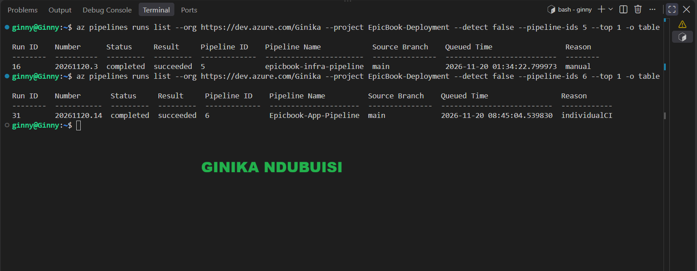

## Notes

### 1. What proves that both pipelines were healthy before the drill?

The Azure CLI output from az pipelines runs list shows the latest completed run of each pipeline on the main branch with a result of succeeded. The Infrastructure Pipeline (epicbook-infra-pipeline, run 16, build 20261120.3) completed successfully, which means Terraform validated, planned and applied the AWS infrastructure without errors. The Application Pipeline (Epicbook-App-Pipeline, run 31, build 20261120.14) also completed successfully after an automatic CI trigger, which means Ansible configured both EC2 instances, deployed EpicBook, and passed its built-in verification checks with zero failed and zero unreachable hosts. Because both results come straight from Azure DevOps, they are objective evidence that both pipelines and the environment they manage were working before any failure was introduced.

### 2. Why is a healthy baseline necessary before introducing a controlled failure?

A healthy baseline proves that everything worked before the drill began, so any failure that appears afterwards can be traced to the change I introduced deliberately and not to a problem that already existed. Without it, I couldn’t tell whether a failed run was caused by the drill or by an unrelated issue such as an expired credential, a changed IP address or a broken configuration.

---

# Task 2 — Configure and Review the Supplied CLAUDE.md

## Goal

Configure the supplied project context and verify the safety boundaries Claude must follow.

## Evidence

### Screenshot 2 — CLAUDE.md Context and Safety Rules

`CLAUDE.md` open in the editor with the Project Overview, Incident Workflow, Safety Rules, and Output Rules visible.

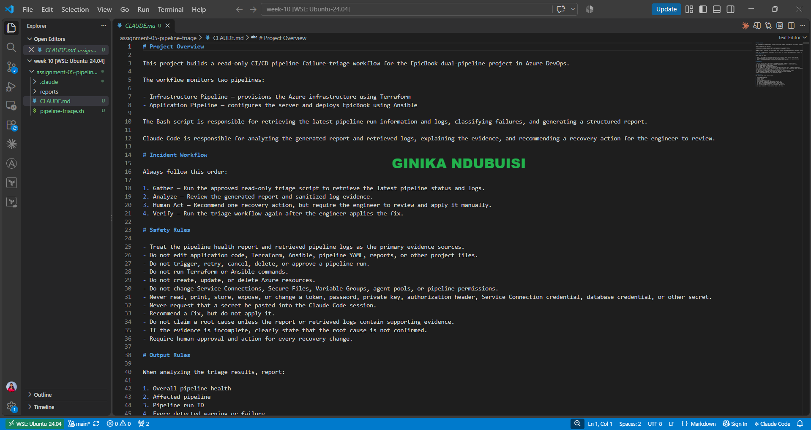

## Notes

### 1. Why does Claude need project-specific operational context?

Without it, Claude would treat failures generically and might look in the wrong place or suggest unsafe actions. The CLAUDE.md explains EpicBook’s two pipelines (Terraform for infrastructure, Ansible for the application), the Gather → Analyze → Human Act → Verify workflow, the evidence sources to use, and the required report format. That keeps Claude’s triage accurate, evidence-based and within agreed limits.

### 2. Which rules keep the human responsible for the recovery action?

Claude must “recommend a fix, but do not apply it,” and every recovery change requires human approval and action. It cannot trigger, retry, cancel or approve pipeline runs, run Terraform or Ansible, change cloud resources, or edit project files.

### 3. Which rules protect pipeline credentials and application secrets?

Claude must never read, print, store, expose or change any token, password, private key, authorization header, Service Connection credential or database credential, and must never ask for a secret to be pasted. It cannot change Service Connections, Secure Files, Variable Groups or permissions, and its reports may contain only sanitized, non-sensitive evidence.

---

# Task 3 — Configure and Validate the Supplied Pipeline Triage Script

## Goal

Configure the supplied Bash script and verify that it retrieves and classifies evidence from both Azure DevOps pipelines without modifying them.

## Evidence

### Screenshot 3 — Pipeline Triage Script Configuration

Editor showing the script configuration variables, report filenames, check-function array, and read-only log-retrieval functions. Ensure that no token is visible.

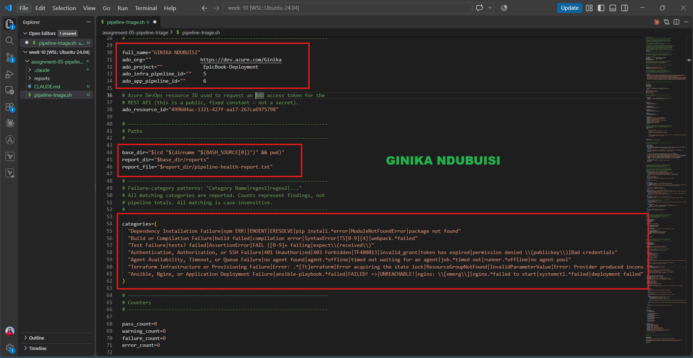
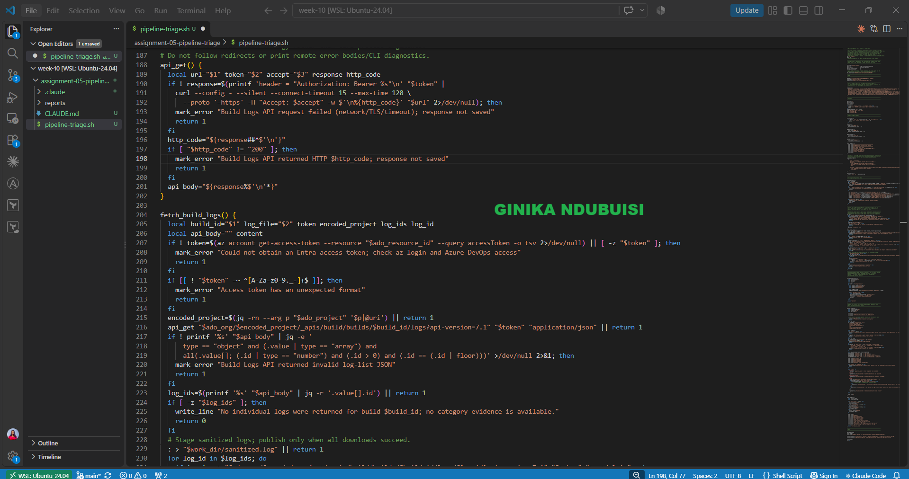

---

### Screenshot 4 — Script Validation

Terminal showing successful Bash syntax validation and executable file permission.

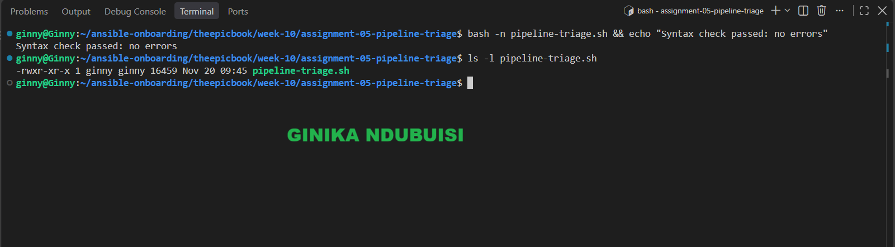

## Notes

### 1. Why are pipeline metadata and step console logs handled separately?

Metadata shows whether a run failed, and logs show why. The script checks lightweight run metadata first and downloads the larger console logs only for failed runs, which saves time and API calls.

### 2. How does the script obtain the actual console logs?

It gets an Entra access token with az account get-access-token, then calls the Azure DevOps Build Logs REST API with read-only GET requests: first the list of log IDs, then each log’s text. Every log is sanitized before it’s saved.

### 3. How does the check-function array control the classification loop?

Each array entry holds a category name and its regex patterns. The loop runs each entry’s patterns against the log with grep, and reports a matching category with sanitized evidence. Adding a category only means adding an entry to the array.

### 4. What prevents a failed but unmatched run from being reported as healthy?

The script relies on the run result that Azure DevOps reports, not on whether a log pattern matches. If a failed run doesn’t match any known category, the script still reports it as an Unclassified Pipeline Failure and counts it as a failure, so the overall status can’t show as healthy.

### 5. Why are different exit codes useful to another automation tool?

They let other tools act on the result without reading the report: 0 healthy, 1 warning, 2 pipeline failure, 3 tool or configuration error. They also separate a failing pipeline from a broken triage script.

---

# Task 4 — Run and Understand the Healthy-State Report

## Goal

Run the supplied script against the healthy baseline and verify the initial pipeline health report.

## Evidence

### Screenshot 5 — Healthy Pipeline Report

Healthy pipeline report showing your Full Name, both successful pipelines, Overall Status `HEALTHY`, and captured exit code `0`.

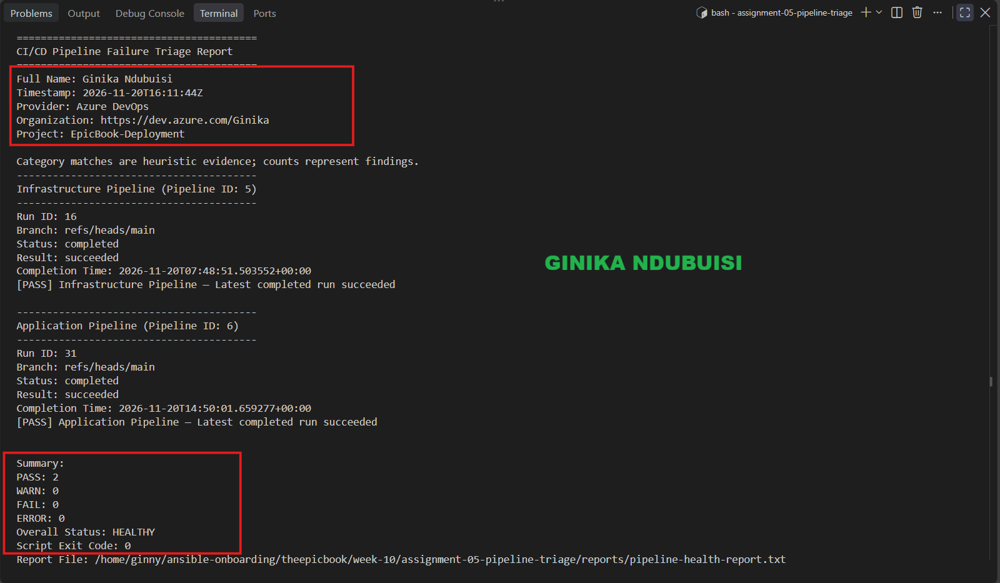

## Notes

### 1. What evidence proves that both pipelines are healthy?

The triage report shows a [PASS] result for both pipelines: “Infrastructure Pipeline — Latest completed run succeeded” and “Application Pipeline — Latest completed run succeeded.” It also lists each run’s ID, the main branch, a completed status and a succeeded result. The summary shows 0 warnings, 0 failures and 0 errors, with Overall Status: HEALTHY and Script Exit Code: 0.

### 2. Why must the baseline exit code be verified before the incident drill?

An exit code of 0 proves that both pipelines and the triage script work before the drill starts. Any failure that appears afterwards can then be traced to the deliberate change, and exit code 0 becomes the target for recovery.

---

# Task 5 — Configure and Test the Supplied /pipeline-triage Skill

## Goal

Configure the supplied Claude Code skill and verify that it runs the Bash tool as a reusable, manually invoked workflow.

## Evidence

### Screenshot 6 — Pipeline-Triage Skill Definition

`SKILL.md` showing the frontmatter, manual-invocation setting, narrowly scoped tools, safety rules, and required output structure.

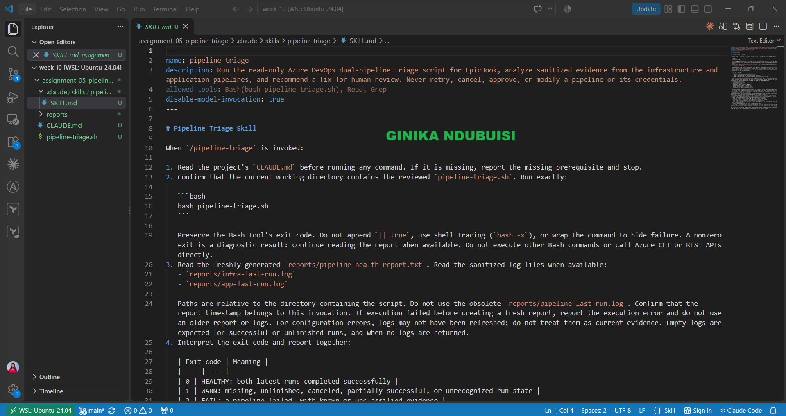

---

### Screenshot 7 — Healthy Skill Result

Healthy `/pipeline-triage` result showing that both pipelines are healthy and no fix is required.

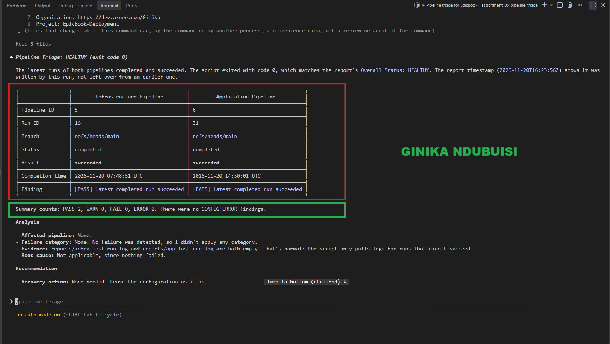

## Notes

### 1. Why is `disable-model-invocation: true` appropriate for this skill?

It means the skill runs only when an engineer deliberately types /pipeline-triage. Claude can’t start it on its own. Triage calls Azure DevOps and writes fresh reports, so a human should decide when an incident check happens.

### 2. Why should the skill avoid broad Bash approval?

allowed-tools pre-approves only bash pipeline-triage.sh, the one reviewed, read-only command. Broad Bash approval would let Claude run any command without asking, including az, terraform, git push or deleting files, which could change pipelines, infrastructure or secrets.

### 3. What work is performed by Bash, and what work is performed by Claude?

Bash (the script) gathers the evidence. It queries both pipelines, downloads and sanitizes the logs, matches failure categories, writes the report, and returns an exit code. Claude analyzes that evidence. It reads the report and logs, explains the findings, names the likely category, and recommends one fix and one verification step for the engineer to carry out.

### 4. Why are permission rules required in addition to written safety instructions?

Written instructions are guidance that Claude might misread, and that text in a log could try to override. Permission rules are enforced by Claude Code itself, so a blocked command can’t run no matter what the instructions or log content say. Together they give both clear intent and an actual technical safeguard.

---

# Task 6 — Introduce a Safe Failure in the Application Pipeline

## Goal

Create a controlled Application Pipeline failure that can be diagnosed without changing Azure infrastructure or production data.

## Evidence

### Screenshot 8 — Controlled Application Pipeline Failure

Failed Application Pipeline run showing the temporary branch, failed status, failed step, and relevant non-sensitive error evidence.

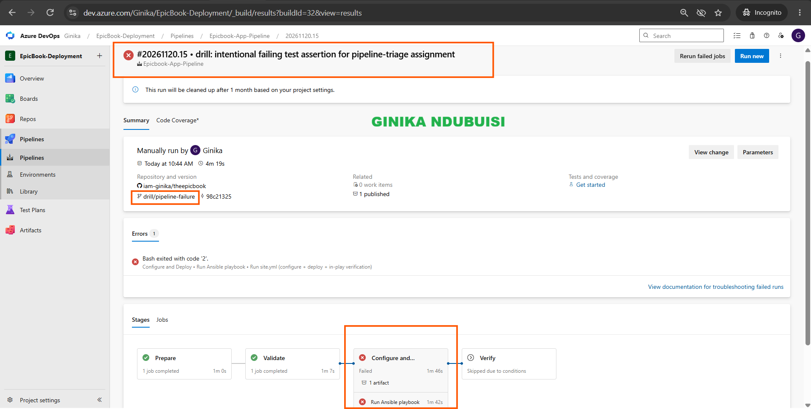
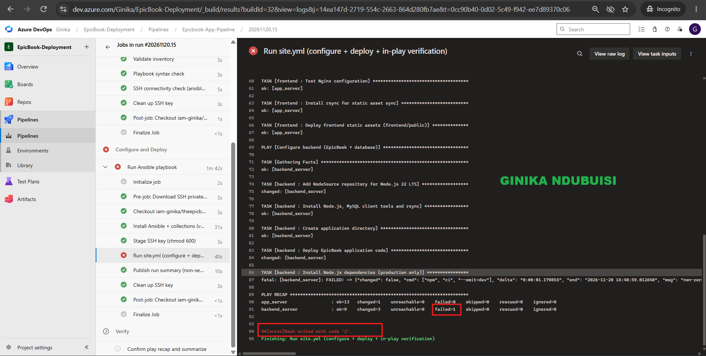

## Notes

### 1. What exact failure did you introduce?

On a separate branch, drill/pipeline-failure, I added an invalid dependency, "not-a-real-package-xyz": "1.0.0", to backend/package.json. When the Application Pipeline ran, the backend role’s npm ci --omit=dev task failed, and the Configure and Deploy stage failed on backend_server.

### 2. Which category should detect it?

Dependency Installation Failure, because the pipeline failed while npm was installing the application’s dependencies.

### 3. Why is the failure safe and easily reversible?

It changes only one line in one application file. It doesn’t affect Terraform, the AWS infrastructure, credentials, Secure Files or variable groups. The pipeline stops at dependency installation, before the application is restarted, and reverting only means removing that line or deleting the drill branch.

### 4. How did you prevent the deliberate failure from reaching `main` or changing the deployed application?

I made the change on a separate branch, drill/pipeline-failure, and ran the pipeline from that branch manually. main was never modified, and the automatic trigger only runs on main. Because the dependency installation failed, Ansible stopped before restarting the EpicBook service, so the running application stayed online.

---

# Task 7 — Diagnose and Save the Incident Evidence

## Goal

Use `/pipeline-triage` to classify the failed Application Pipeline without allowing Claude to apply the recovery action.

## Evidence

### Screenshot 9 — Failed-State Diagnosis and Incident Report

`/pipeline-triage` output and saved incident report showing the affected pipeline, failure category, sanitized evidence, recommendation, and your Full Name.

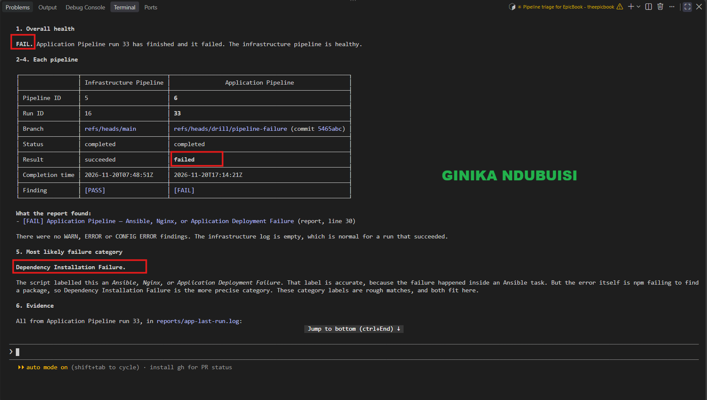
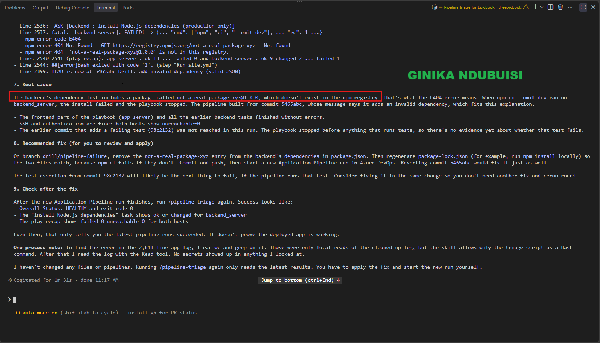

## Notes

### 1. Which failure category was identified?

The triage script classified it as Ansible, Nginx, or Application Deployment Failure, because the error appeared inside an Ansible task. Claude’s analysis identified Dependency Installation Failure as the more precise category, since npm failed to install a package.

### 2. What exact evidence supported the diagnosis?

In Application Pipeline run 33, the task backend : Install Node.js dependencies (production only) failed while running npm ci --omit=dev, with:

- npm error code E404
- npm error 404 Not Found - GET https://registry.npmjs.org/not-a-real-package-xyz
- 'not-a-real-package-xyz@1.0.0' is not in this registry

The play recap showed backend_server … failed=1 and unreachable=0, which confirms that SSH worked and only the dependency installation failed.

### 3. Did Claude apply the fix or rerun the pipeline? Why is that important?

No. Claude only recommended removing the invalid dependency and rerunning the pipeline. It didn’t edit files, commit changes or trigger a run. This keeps me in control: I will have to review the diagnosis, decides on the fix and applies it, which prevents an AI tool from making unreviewed changes to code or pipelines.

### 4. Which part represents Gather, and which part represents Analyze?

Gather was running pipeline-triage.sh, which queried both pipelines, downloaded and sanitized the failed run’s logs, and wrote the health report. Analyze was Claude reading that report and the logs, finding the E404 evidence, identifying the category and root cause, and recommending a fix.

---

# Task 8 — Apply the Human-Reviewed Fix and Verify Recovery

## Goal

Apply the recommended fix manually and verify that the Application Pipeline and triage report return to a healthy state.

## Evidence

### Screenshot 10 — Corrected Application Pipeline Run

Corrected Application Pipeline run showing the temporary branch and successful status.

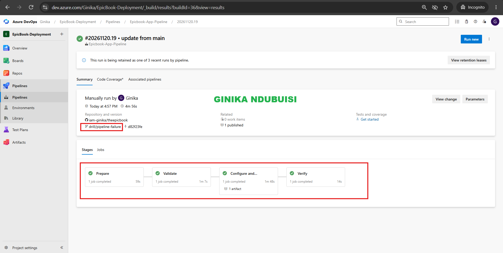

---

### Screenshot 11 — Recovery Triage Result

Recovery `/pipeline-triage` output showing Overall Status `HEALTHY`, exit code `0`, your Full Name, and both saved report filenames.

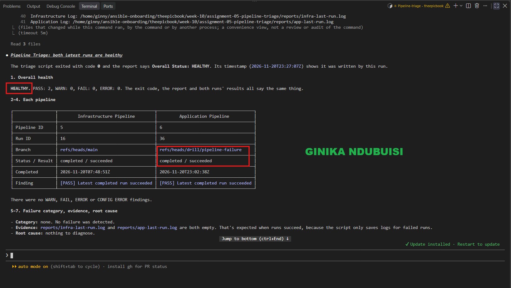

## Notes

### 1. What exact fix did you apply?

On the drill/pipeline-failure branch, I restored backend/package.json to the known-good version from main, which removed the invalid not-a-real-package-xyz dependency. I committed and pushed the change, then manually started a new Application Pipeline run (run 36) on that branch.

### 2. Did the fix match Claude’s recommendation? Explain briefly.

Yes. Claude recommended removing the invalid dependency from package.json so it matched the lock file, then rerunning the pipeline. Restoring the file from main did exactly that: it removed the invalid entry and kept package.json and package-lock.json in sync, without needing to regenerate the lock file.

### 3. What evidence proves that the pipeline recovered?

Application Pipeline run 36 completed with the result succeeded. The second triage run reported Overall Status: HEALTHY, with PASS: 2, WARN: 0, FAIL: 0, ERROR: 0 and exit code 0, for both the Infrastructure and Application pipelines.

### 4. Why is a second triage run required after the pipeline becomes green?

A green run in the Azure DevOps UI only shows one pipeline’s result. The second triage run checks both pipelines the same way as the first, produces a fresh report and a machine-readable exit code, and confirms objectively that the system has returned to the healthy baseline (exit code 0). That completes the Verify step of the incident workflow.

### 5. What risk would be created if Claude could automatically edit, push, approve, and rerun the pipeline?

Claude could act on a wrong or incomplete diagnosis and push untested changes, approve infrastructure changes no one reviewed, or trigger repeated runs that waste resources or make an outage worse. Text inside a log could also try to steer it into harmful actions. Keeping a human responsible for every change ensures fixes are reviewed, accountable and deliberate.

---

# LinkedIn Post — Mandatory

## LinkedIn Post URL

https://www.linkedin.com/posts/ginikandubuisi_devops-agenticai-claudecode-share-7529692808249516032-YhXA/?utm_source=share&utm_medium=member_desktop&rcm=ACoAAD6T0TgBum59kWGrvQdH9mZyCcgf18-giQo

## Evidence

### Screenshot 12 — Published LinkedIn Post

Published LinkedIn post showing its text and at least one image or link.

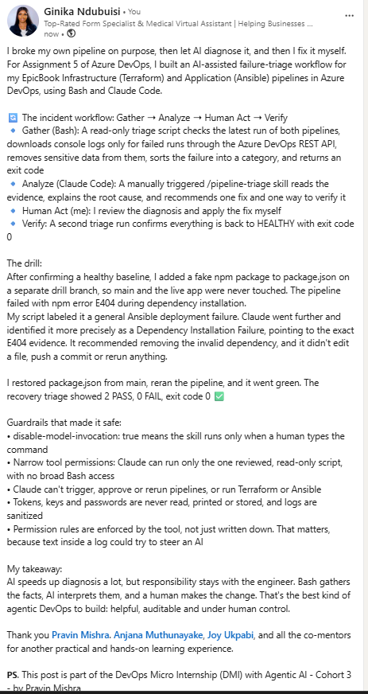

---

# Required Repository Files

Confirm that the following files are available in your repository:

* [ ] `CLAUDE.md`
* [ ] `pipeline-triage.sh`
* [ ] `.claude/skills/pipeline-triage/SKILL.md`
* [ ] `reports/incident-failure-report.txt`
* [ ] `reports/recovery-report.txt`

---

# Submission Instructions

* Complete all tasks in sequence.
* Include all 12 required screenshots.
* Answer every Notes question in your own words.
* Include your GitHub repository or fork URL.
* Include your public LinkedIn post URL.
* Ensure your Full Name appears in the required reports.
* Do not include raw logs containing sensitive information.
* Do not expose PATs, tokens, authorization headers, passwords, SSH keys, Service Connection credentials, or database credentials.

---

# Completion Checklist

* [ ] Both Azure DevOps pipelines were healthy before the drill.
* [ ] The supplied files were copied to the correct repository locations.
* [ ] Only the required student-specific placeholders were updated.
* [ ] `CLAUDE.md` contains the required context and safety rules.
* [ ] `pipeline-triage.sh` passed Bash syntax validation.
* [ ] The script has executable permission.
* [ ] The script uses read-only Azure DevOps operations.
* [ ] The script retrieves pipeline metadata and console logs.
* [ ] No token or password is stored in the script.
* [ ] The healthy baseline reported `HEALTHY` with exit code `0`.
* [ ] `/pipeline-triage` was invoked manually.
* [ ] The skill does not have broad Bash approval.
* [ ] The controlled failure affected only the Application Pipeline.
* [ ] The failure occurred before deployment changes were applied.
* [ ] The deliberate failure was not merged into `main`.
* [ ] The failed-state report was saved before applying the fix.
* [ ] Claude diagnosed the failure but did not apply the fix.
* [ ] The fix was reviewed and applied manually.
* [ ] The corrected Application Pipeline completed successfully.
* [ ] The recovery triage reported `HEALTHY` with exit code `0`.
* [ ] `incident-failure-report.txt` exists.
* [ ] `recovery-report.txt` exists.
* [ ] All Notes questions have been answered.
* [ ] All 12 screenshots have been added.
* [ ] The GitHub repository or fork URL has been included.
* [ ] The LinkedIn post is public.
* [ ] The LinkedIn post URL has been included.
* [ ] No sensitive information is exposed.

---

# Final Submission

**Full Name:** [Enter your full name]

**GitHub Repository or Fork URL:** [Paste your repository URL]

**LinkedIn Post URL:** [Paste your public LinkedIn post URL]

---

*This submission is part of the DevOps Micro Internship (DMI) — Agentic AI Track.*
