# Assignment 5 — Kubernetes Health Probes (Readiness)

Part of the DevOps Micro Internship (DMI) with Agentic AI

---

## Purpose

In this assignment, you will configure and test a Kubernetes readiness probe. You will create a baseline NGINX Deployment, add an HTTP readiness probe, intentionally break it, observe a stalled rollout, and restore the working configuration.

You will also demonstrate how readiness probes protect rolling updates.

---

# Task 0 — Prepare the Lab Environment

## Goal

Confirm that you are connected to your learning cluster and remove the previous assignment’s HPA and NGINX Deployment before starting this lab.

No screenshot or written notes are required for this pre-check.

---

# Task 1 — Set Up Your Lab Directory

## Goal

Create and enter a dedicated directory for the readiness-probe lab.

### Evidence

#### Screenshot 1 — Terminal showing that you are working inside `~/k8s-labs/health-probes-readiness`

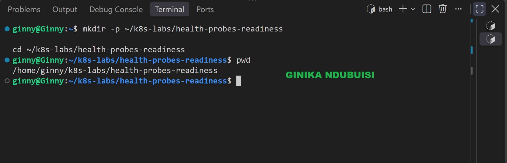

---

### Notes

**1. What is the purpose of a readiness probe?**

The purpose is to tell Kubernetes when a container is actually able to serve requests. Until the probe passes, the Pod is marked NotReady and doesn't count as available.

**2. Why is a Pod being Running not always enough to confirm it can serve traffic?**

Running only means the container process has started. The app inside may still be booting, loading config, warming caches or waiting on a database, so it can't handle requests yet.

---

# Task 2 — Create a Baseline Deployment Without Probes

## Goal

Create a baseline NGINX Deployment with two replicas and no readiness probe.

### Evidence

#### Screenshot 2 — Completed `00-nginx-deploy-baseline.yaml` manifest

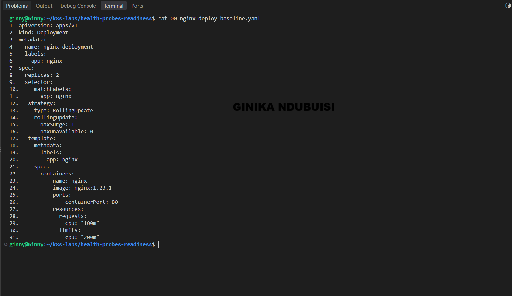

---

#### Screenshot 3 — Output showing a successful rollout and two running NGINX Pods

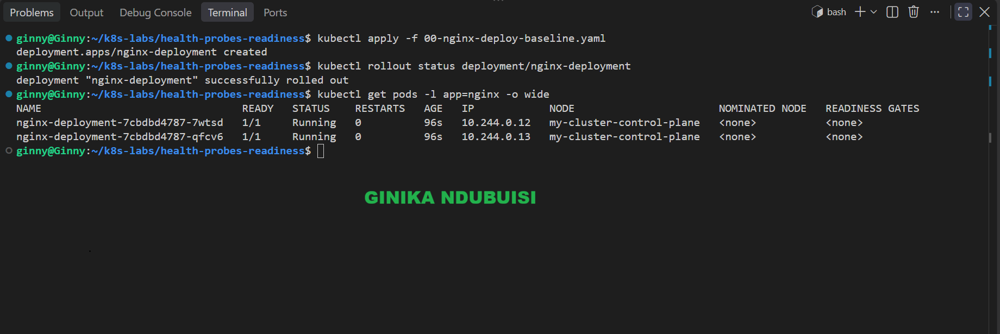

---

#### Screenshot 4 — Relevant output from `kubectl describe deployment nginx-deployment`

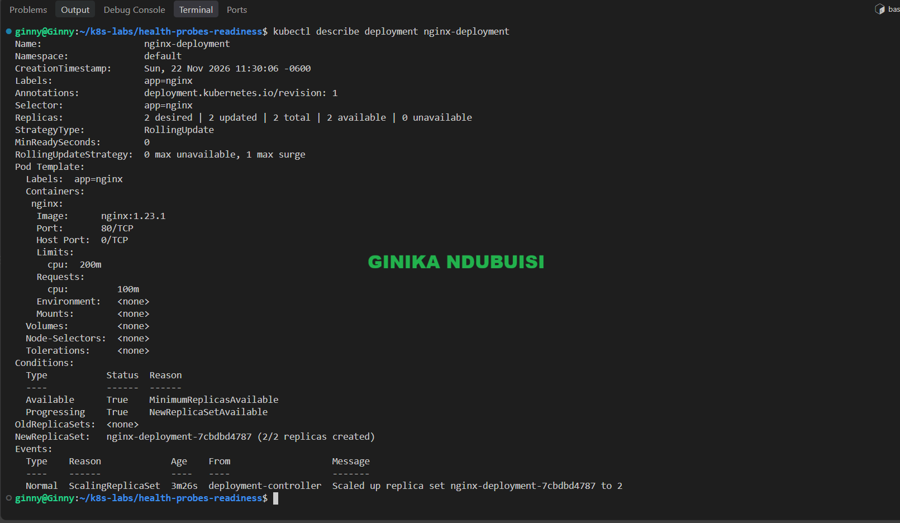

---

### Notes

**1. How many replicas does this Deployment maintain?**

Two (2)

**2. What does `maxUnavailable: 0` mean during a rolling update?**

It means during an update, Kubernetes may never drop below 2 available Pods. It must bring a new Pod up and get it ready before it removes an old one.

**3. Is a readiness probe configured in this baseline Deployment?**

No. Without a readiness probe, Kubernetes marks the Pod Ready as soon as the container starts, without checking whether NGINX can serve traffic.
---

# Task 3 — Add a Readiness Probe

## Goal

Add an HTTP readiness probe so Kubernetes checks whether each NGINX container is ready to accept requests.

### Evidence

#### Screenshot 5 — Completed `01-nginx-deploy-readiness.yaml` manifest showing the readiness probe

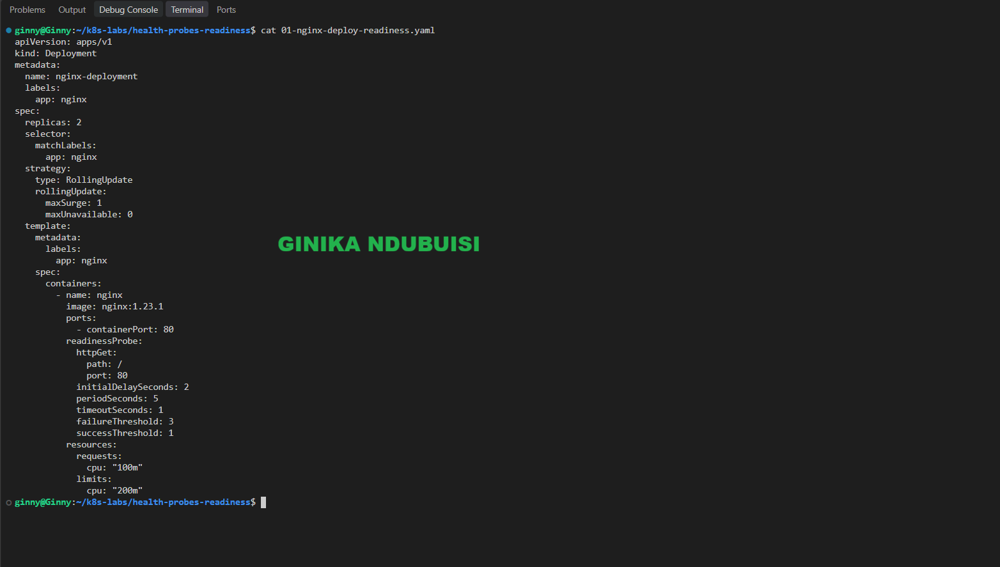

---

#### Screenshot 6 — Output of the successful rollout and ready Pods

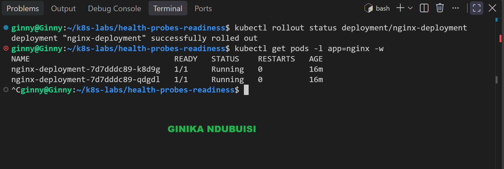

---

#### Screenshot 7 — Pod description showing readiness conditions and readiness probe details

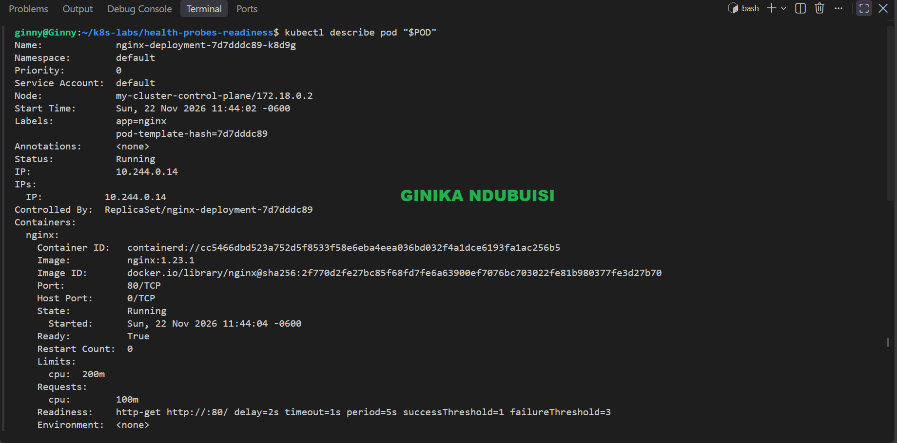
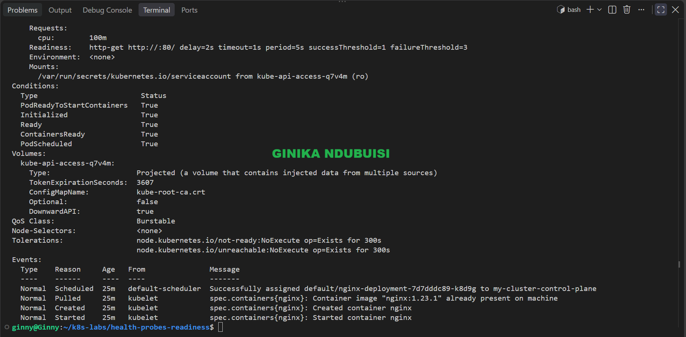

---

### Notes

**1. What path and port does the readiness probe check?**

The probe sends an HTTP GET request to the root path `/` on port `80`, which is the NGINX root page.

**2. What does `initialDelaySeconds: 2` do?**

It makes Kubernetes wait 2 seconds after the container starts before running the first readiness check, so NGINX has time to start.

**3. What does `periodSeconds: 5` do?**

It makes Kubernetes run the readiness check every 5 seconds.

**4. What must happen before Kubernetes considers this Pod ready?**

The container has to start, and then, after the 2-second initial delay, the readiness probe has to succeed. That means an HTTP GET to `/` on port 80 gets back a success status (200–399) within the 1-second timeout. Kubernetes then marks the Pod `Ready`, and it shows `1/1` in the READY column. Until then, the Pod stays NotReady even though it is Running.

---

# Task 4 — Break and Restore Readiness

## Goal

Intentionally fail the readiness probe, observe the NotReady behavior, and then restore the working probe configuration.

### Evidence

#### Screenshot 8 — `02-nginx-readiness-broken.yaml` showing `/does-not-exist`

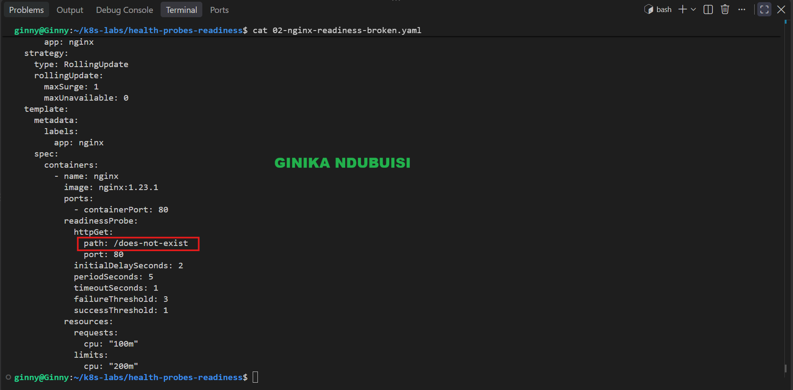

---

#### Screenshot 9 — Output showing the rollout timeout or incomplete rollout

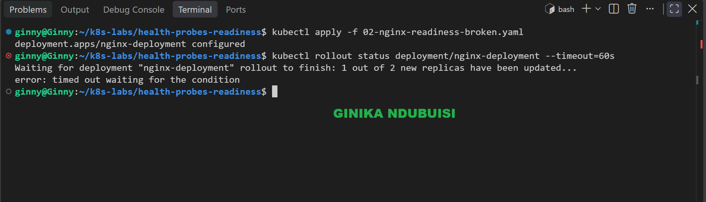

---

#### Screenshot 10 — Pod details showing `Ready: False` or readiness-probe failure events

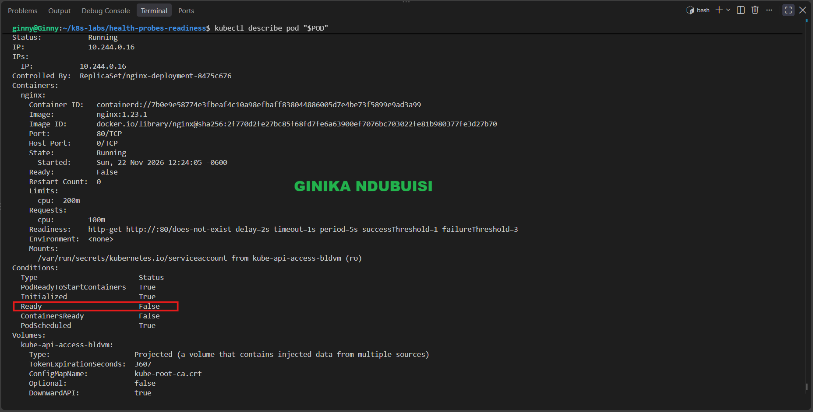

---

#### Screenshot 11 — Output showing successful rollout and ready Pods after the fix

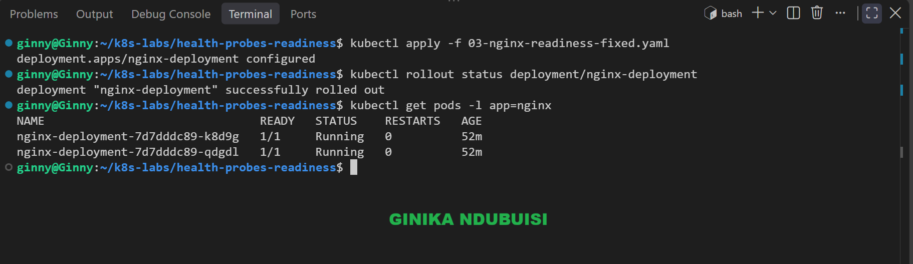

---

### Notes

**1. Why did the readiness probe fail?**

The probe path was changed to `/does-not-exist`, a page NGINX doesn't have. 

**2. What happened to the Pod readiness status?**

The new Pod kept running but never became Ready. It showed 0/1 in the READY column, its Pod conditions showed Ready: False

**3. Why did the rollout fail to complete?**

With maxUnavailable: 0, Kubernetes can't remove an old Pod until a new Pod is Ready. The new Pod never passed its readiness probe, so the rollout stalled and timed out after 60 seconds. The two old Pods kept running.

**4. How did you restore the Deployment successfully?**

I created 03-nginx-readiness-fixed.yaml by copying the working 01 manifest, which has the probe path set back to /, and applied it. The new Pods passed the readiness probe and became 1/1 Ready, and the rollout completed successfully.

---

# Task 5 — See How Readiness Protects Rolling Updates

## Goal

Observe how readiness prevents a bad new Pod from replacing healthy Pods during a rolling update.

### Evidence

#### Screenshot 12 — Successful update command and rollout status

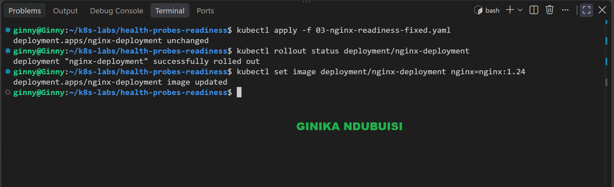

---

#### Screenshot 13 — ReplicaSets and Pods after the successful rolling update

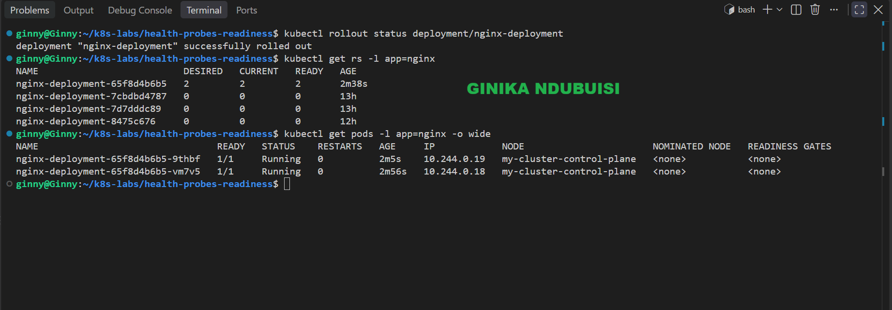

---

#### Screenshot 14 — Completed `04-readiness-broken-patch.yaml`

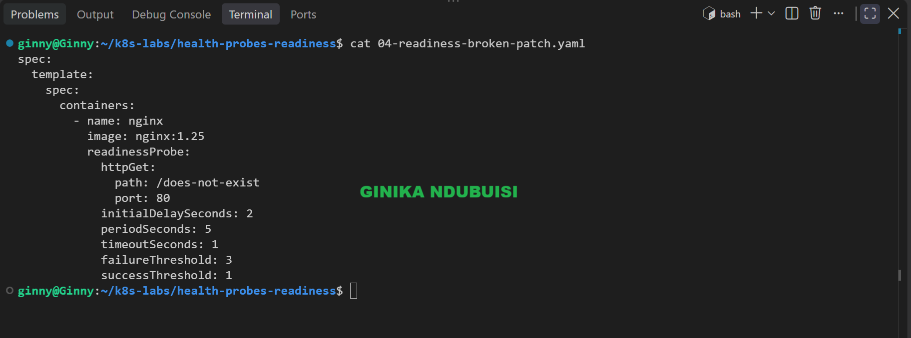

---

#### Screenshot 15 — Output showing the expected stalled rollout or timeout

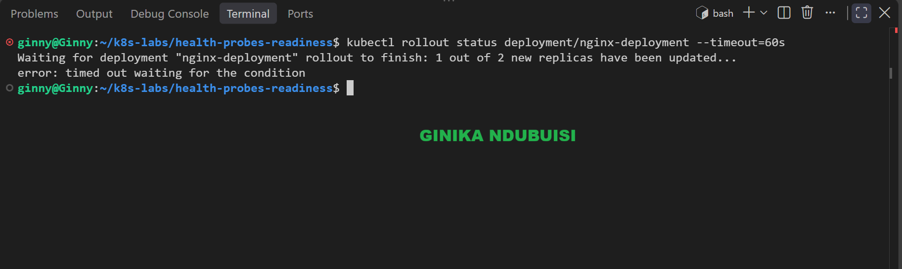

---

#### Screenshot 16 — Deployment or Pod output showing the effect of the broken readiness probe

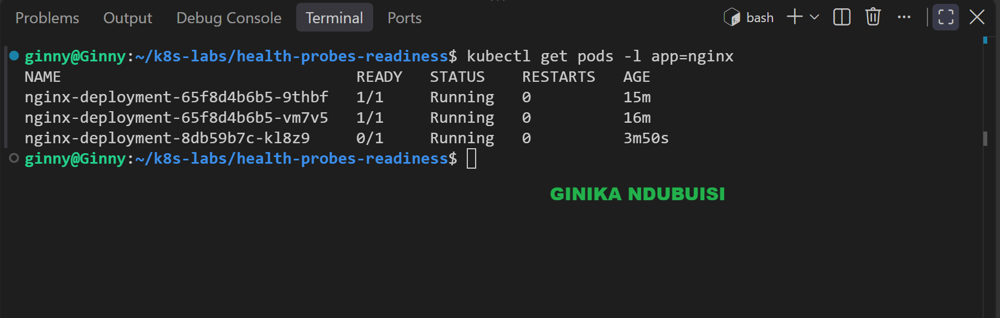

---

#### Screenshot 17 — Successful rollout status after restoring the fixed configuration

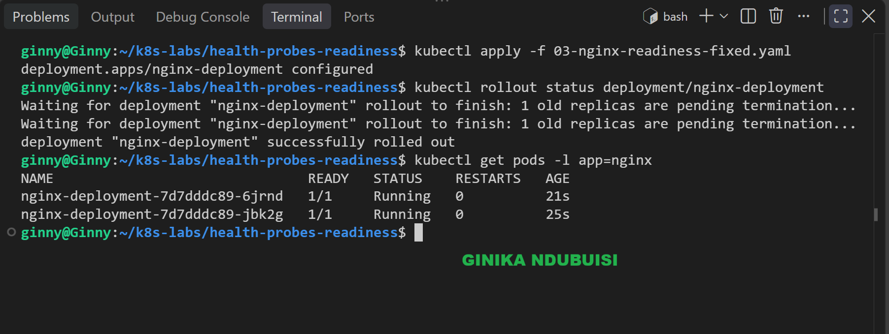

---

### Notes

**1. What happened during the successful rolling update?**

When I changed the image from nginx:1.23.1 to nginx:1.24, Kubernetes created one extra Pod (maxSurge: 1) running the new image. It waited for that Pod to pass its readiness probe, then removed one old Pod, and repeated until both Pods were running nginx:1.24. The Deployment never had fewer than 2 available Pods during the update.

**2. Why did Kubernetes create a new ReplicaSet?**

Changing the image changed the Pod template, and each distinct Pod template gets its own ReplicaSet. Kubernetes scaled the new ReplicaSet up to 2 and the old one down to 0. The old ReplicaSet is kept so the Deployment can be rolled back.

**3. Why were the new Pods unable to replace the existing healthy Pods after readiness was broken?**

The patch changed the image to nginx:1.25 and set the probe path to /does-not-exist. The new Pod got error on every check, so it stayed 0/1 and never counted as available. Kubernetes only removes old Pods once new ones are Ready, so the two healthy nginx:1.24 Pods kept running and the rollout stalled.

**4. How does `maxUnavailable: 0` protect availability during this rollout?**

It means no Pod can be taken away until its replacement is Ready, so the Deployment always keeps its 2 desired Pods available. When the new Pod failed readiness, the two healthy old Pods stayed in place. The bad release stalled instead of causing downtime, until I fixed it by applying 03-nginx-readiness-fixed.yaml.

---

# Task 6 — Share Your Readiness-Probe Learning on LinkedIn

## Goal

Share what you learned about Kubernetes readiness probes and how they protect rolling updates.

### Evidence

#### Screenshot 18 — Published LinkedIn post

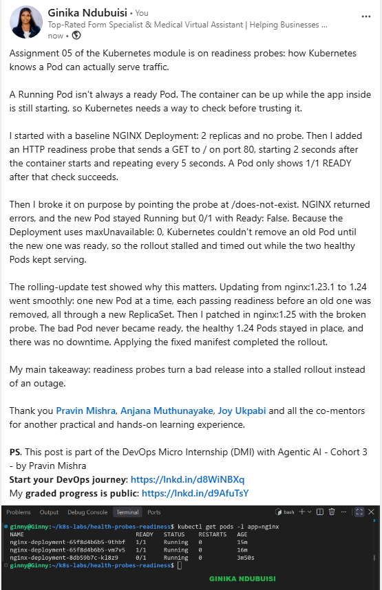

#### Linkedin post link

https://www.linkedin.com/posts/ginikandubuisi_assignment-05-of-the-kubernetes-module-is-share-7531694335080177664-O_8J/?utm_source=share&utm_medium=member_desktop&rcm=ACoAAD6T0TgBum59kWGrvQdH9mZyCcgf18-giQo

---

# Submission Instructions

- Add all required screenshots numbered 1–18.
- Ensure your full name is visible in required screenshots.
- Use clear, readable screenshots showing the relevant manifest or output.
- Include the completed baseline and readiness-probe manifests in your repository.
- Answer all Notes questions for Tasks 1–5 in your own words.
- Include evidence of the intentional readiness failure and successful recovery.
- Do not expose tokens, passwords, kubeconfig files, account IDs, or other sensitive information.

---

# Completion Checklist

- [ ] Learning cluster confirmed and previous assignment resources removed where applicable
- [ ] Readiness-probe lab directory created (Screenshot 1)
- [ ] Baseline Deployment created successfully (Screenshot 2)
- [ ] Two baseline Pods running and successful rollout verified (Screenshot 3)
- [ ] Baseline Deployment details reviewed (Screenshot 4)
- [ ] Readiness probe added successfully (Screenshot 5)
- [ ] Successful readiness rollout verified (Screenshot 6)
- [ ] Pod readiness conditions and probe details inspected (Screenshot 7)
- [ ] Broken readiness configuration created (Screenshot 8)
- [ ] Stalled rollout or timeout observed (Screenshot 9)
- [ ] NotReady status or readiness-probe failure events captured (Screenshot 10)
- [ ] Working readiness configuration restored (Screenshot 11)
- [ ] Successful image update completed (Screenshot 12)
- [ ] ReplicaSets and Pods inspected after the update (Screenshot 13)
- [ ] Broken-readiness patch created (Screenshot 14)
- [ ] Stalled rollout observed after the patch (Screenshot 15)
- [ ] Effect of broken readiness captured (Screenshot 16)
- [ ] Final recovery completed (Screenshot 17)
- [ ] LinkedIn post published (Screenshot 18)
- [ ] Notes for Tasks 1–5 completed
- [ ] Required manifests included
- [ ] All screenshots are clear and readable
- [ ] No sensitive data exposed

---

## 📌 About DMI & CloudAdvisory

DevOps Micro Internship (DMI) is a project-based DevOps program run by Pravin Mishra (The CloudAdvisory) focused on real-world execution, systems thinking, and career readiness.

It helps learners build strong DevOps foundations with hands-on experience.

---

## 📌 Resources

- 🌐 DMI Official Website: https://dmi.pravinmishra.com?utm_source=github&utm_medium=readme  
- 🎓 University: https://university.pravinmishra.com?utm_source=github&utm_medium=readme  
- 💬 Discord Community: https://discord.pravinmishra.com?utm_source=github&utm_medium=readme  
- 📝 Blog: https://dmi.pravinmishra.com/blog?utm_source=github&utm_medium=readme  
- ▶️ YouTube Playlist: https://www.youtube.com/playlist?list=PLFeSNDtI4Cho  
- 🔗 Pravin Mishra (LinkedIn): https://www.linkedin.com/in/pravin-mishra-aws-trainer/  
- 🏢 CloudAdvisory (LinkedIn): https://www.linkedin.com/company/thecloudadvisory/

---

*This submission is part of DevOps Micro Internship (DMI) — Agentic AI Track.*
