# Assignment 6 — Kubernetes Health Probes (Liveness)

Part of the DevOps Micro Internship (DMI) with Agentic AI

---

## Purpose

In this assignment, you will configure and test a Kubernetes liveness probe. You will create a baseline NGINX Deployment, add an HTTP liveness probe, intentionally make it fail, observe container restarts, and restore the working configuration.

---

# Task 0 — Prepare the Lab Environment

## Goal

Confirm that you are connected to your learning cluster and remove the previous HPA and NGINX Deployment before starting this lab.

No screenshot or written notes are required for this pre-check.

---

# Task 1 — Set Up Your Lab Directory

## Goal

Create and enter a dedicated directory for the liveness-probe lab.

### Evidence

#### Screenshot 1 — Terminal showing that you are working inside `~/k8s-labs/health-probes-liveness`

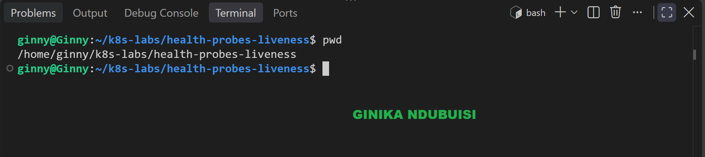

---

### Notes

**1. What problem does a liveness probe solve?**

A liveness probe catches containers that are still running but stuck: deadlocked, hung, or frozen in a state they can't recover from on their own. Kubernetes keeps checking the container, and if the probe fails failureThreshold times in a row, Kubernetes kills the container and restarts it. Without a liveness probe, a hung container could stay Running indefinitely and never be fixed.

**2. What is the key difference between a readiness probe and a liveness probe?**

A readiness probe decides whether a Pod should receive traffic. When it fails, Kubernetes marks the Pod NotReady but leaves the container running. A liveness probe decides whether a container is still healthy. When it fails, Kubernetes restarts the container. Readiness means "not ready yet, wait"; liveness means "broken, restart it".

---

# Task 2 — Create a Baseline Deployment Without Probes

## Goal

Create a baseline NGINX Deployment with two replicas and no health probes.

### Evidence

#### Screenshot 2 — Completed `00-nginx-deploy-baseline.yaml` manifest

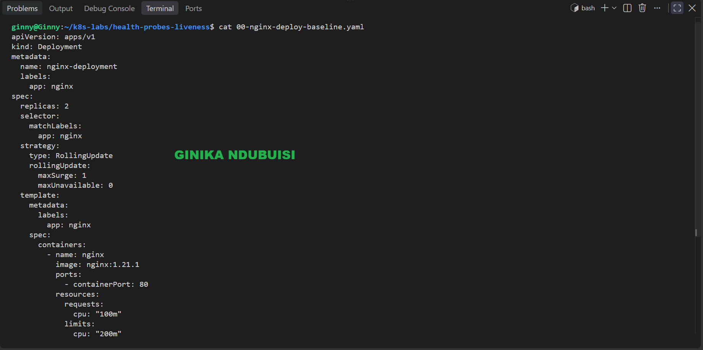

---

#### Screenshot 3 — Output showing a successful rollout and two running NGINX Pods

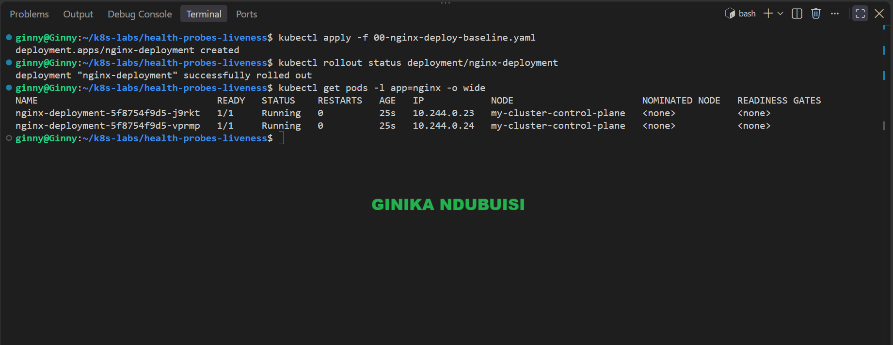

---

#### Screenshot 4 — Relevant output from `kubectl describe deployment nginx-deployment`

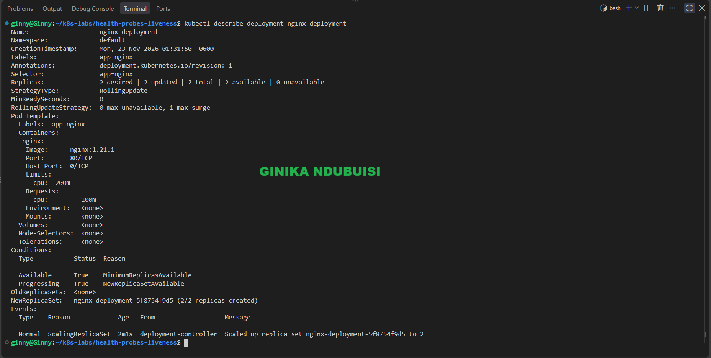

---

### Notes

**1. How many replicas does this Deployment maintain?**

Two. The describe output shows "2 desired | 2 updated | 2 total | 2 available | 0 unavailable", so both NGINX Pods are running and available.

**2. Are any health probes configured in the baseline Deployment?**

No. There are no readiness or liveness probes in the baseline. Kubernetes starts the containers and keeps them running, but it doesn't check whether NGINX is ready or healthy.

**3. Why is a baseline useful before adding a liveness probe?**

It shows how the Deployment behaves normally before anything changes.
---

# Task 3 — Add a Liveness Probe

## Goal

Add an HTTP liveness probe so Kubernetes can periodically check whether the NGINX container is still responsive.

### Evidence

#### Screenshot 5 — Completed `01-nginx-deploy-liveness.yaml` manifest showing the liveness probe

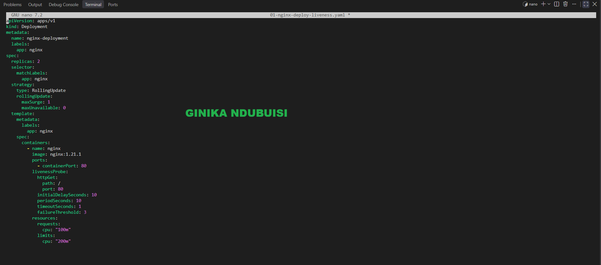

---

#### Screenshot 6 — Output showing successful rollout and running Pods

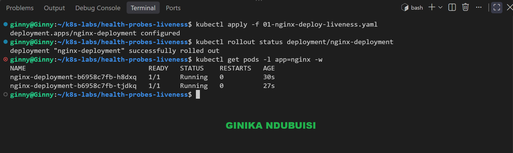

---

#### Screenshot 7 — Pod description showing liveness-probe details

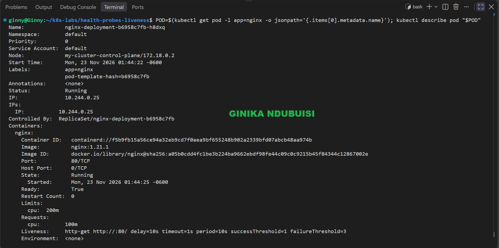
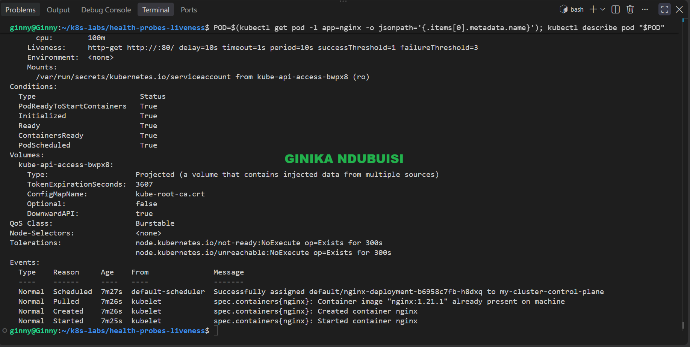

---

### Notes

**1. What path and port does the liveness probe check?**

The probe sends an HTTP GET request to path / on port 80, the NGINX root page.

**2. What does `initialDelaySeconds: 10` do?**

It makes Kubernetes wait 10 seconds after the container starts before running the first liveness check. That gives NGINX time to start up, so it isn't restarted before it's had a chance to run.

**3. What does `failureThreshold: 3` mean?**

The liveness check has to fail 3 times in a row before Kubernetes treats the container as unhealthy and restarts it. With a 10-second period, that's about 30 seconds of failed checks. A single slow or missed response won't trigger a restart.

**4. Does a successful liveness probe control whether a Pod receives traffic? Explain briefly.**

No. A liveness probe only decides whether Kubernetes should restart the container. Whether a Pod receives traffic is controlled by the readiness probe. In this Deployment there's no readiness probe, so the Pod is marked Ready as soon as the container is running, as the Ready: True in the output shows.

---

# Task 4 — Trigger and Observe a Liveness Restart

## Goal

Intentionally make the liveness probe fail and observe Kubernetes restart the unhealthy container.

### Evidence

#### Screenshot 8 — `02-nginx-liveness-broken.yaml` showing `/does-not-exist`

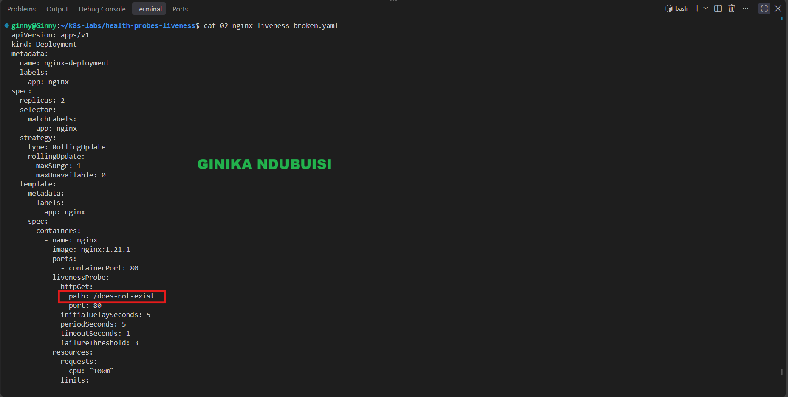

---

#### Screenshot 9 — Pod output showing an increased RESTARTS count

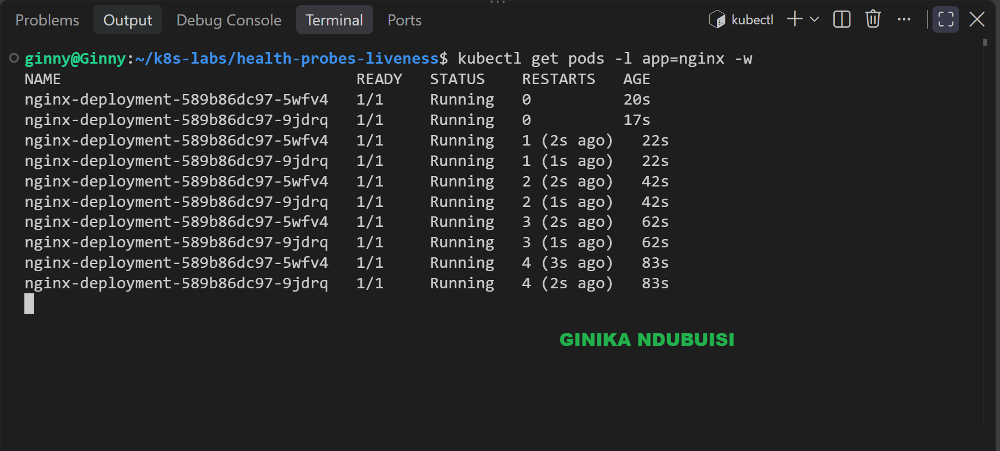
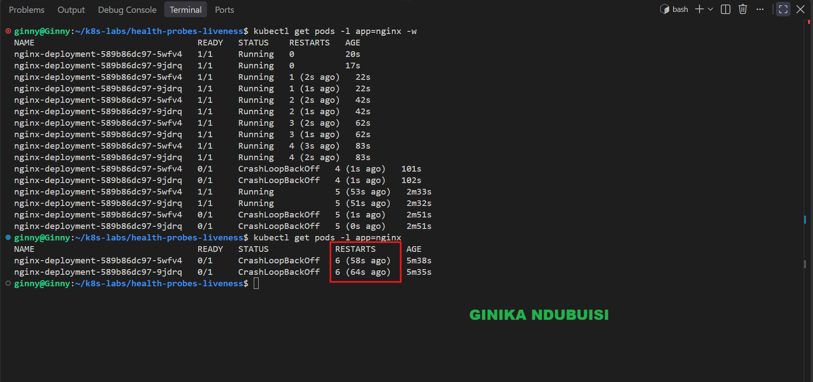

---

#### Screenshot 10 — Pod description showing liveness-probe failure events or restart details

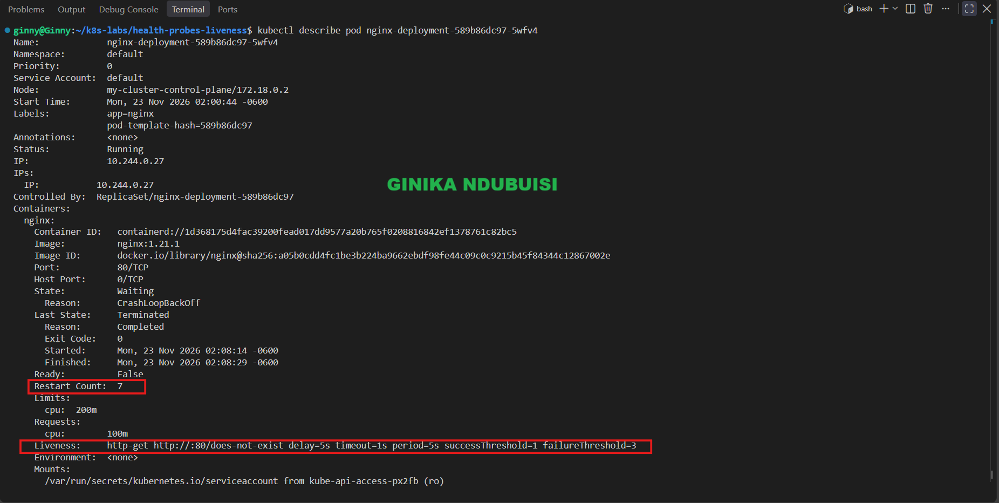
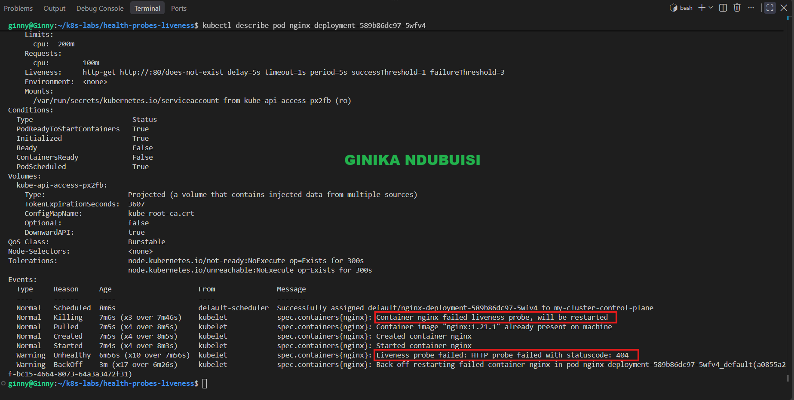

---

#### Screenshot 11 — Output showing stable running Pods after applying the fixed configuration

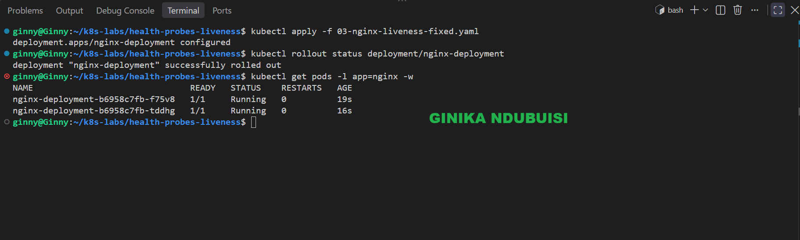

---

### Notes

**1. Why did the liveness probe fail?**

The probe path was changed to /does-not-exist, a page NGINX doesn't have. NGINX returned a 404 status on every check, and Kubernetes counts anything outside 200–399 as a failure.

**2. What happened after Kubernetes detected repeated liveness-probe failures?**

Kubernetes killed the container and restarted it. The new container failed the same check, so the cycle repeated. After several restarts, the Pods went into CrashLoopBackOff, where Kubernetes waits longer before each new restart attempt.

**3. What does the RESTARTS column prove?**

It proves that Kubernetes was restarting the containers. The count went up from 0 to 7 while the Pods stayed in Running status, which shows the liveness probe was detecting unhealthy containers and Kubernetes was restarting them automatically, with no manual action.

**4. How did you restore the Deployment to a stable state?**

I copied the working configuration from 01-nginx-deploy-liveness.yaml into 03-nginx-liveness-fixed.yaml, which sets the probe path back to /, and applied it. Kubernetes rolled out new Pods that passed the liveness checks. They stayed 1/1 Running, and their restart count stayed at 0.

---

# Task 5 — Optional: Observe a Restart Loop

## Goal

Observe why overly aggressive or incorrectly configured liveness probes can create restart loops.

Complete this section only if you attempt Task 5. Otherwise, mark it as “Not attempted.”

**Task status:** Completed / Not attempted

### Evidence

#### Optional Screenshot — Pod output showing the RESTARTS count increasing during the restart-loop observation

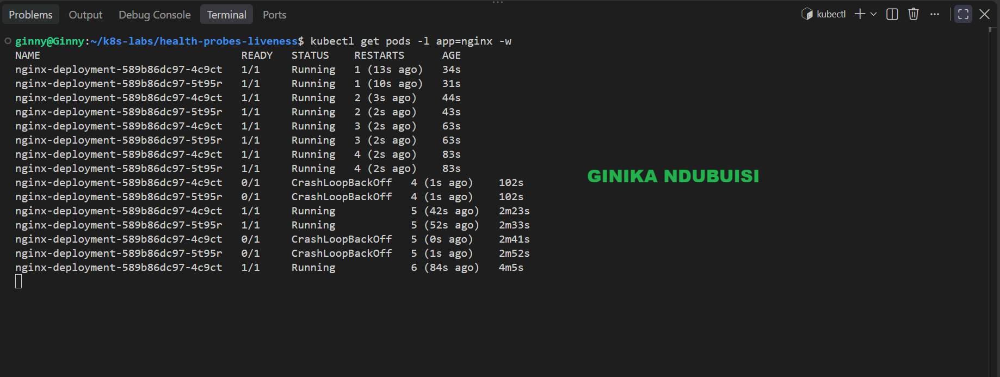

No specific restart count or CrashLoopBackOff status is required.

---

### Notes — Answer Only If Attempted

**1. What is a restart loop?**

A restart loop happens when a container keeps failing and Kubernetes keeps restarting it, over and over. In this lab, the broken liveness probe failed on every new container, so the restart count kept going up. Kubernetes then added longer waits between attempts, which shows up as CrashLoopBackOff.

**2. Why can an aggressive liveness probe be harmful?**

If the probe starts too early, runs too often, has a very short timeout, or restarts after too few failures, it can kill a container that is actually healthy, just slow to start or briefly busy under load. Those unnecessary restarts cause downtime, throw away in-progress requests, and can trap the application in a restart loop. The probe ends up causing the very outage it was meant to prevent.

**3. Why should liveness checks be lightweight and carefully tuned?**

The check runs every few seconds for the life of the container, so it has to be cheap, like hitting a simple health endpoint, not running database queries or calling other services. If it depends on something outside the container, an outage in that dependency would restart every Pod even though the app itself is fine. Settings like initialDelaySeconds, timeoutSeconds and failureThreshold need to match how the app really behaves, so Kubernetes only restarts a container that is truly stuck.

---

# Task 6 — Share Your Liveness-Probe Learning on LinkedIn

## Goal

Share what you learned about Kubernetes liveness probes, container restarts, and the difference between readiness and liveness.

### Evidence

#### Screenshot 12 — Published LinkedIn post

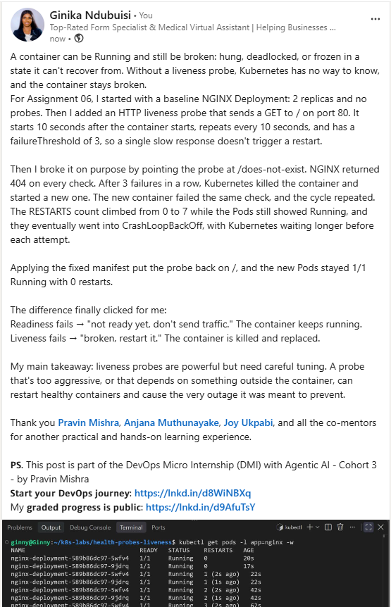

#### Linkedin post URL

https://www.linkedin.com/posts/ginikandubuisi_a-container-can-be-running-and-still-be-broken-share-7531695574576721921-MGyG/?utm_source=share&utm_medium=member_desktop&rcm=ACoAAD6T0TgBum59kWGrvQdH9mZyCcgf18-giQo

---

# Submission Instructions

- Add all required screenshots numbered 1–12.
- Include the optional Task 5 screenshot only if you attempt that task.
- Ensure your full name is visible in required screenshots.
- Use clear, readable screenshots showing the relevant manifest or output.
- Include the completed baseline and liveness-probe manifests in your repository.
- Answer all Notes questions for Tasks 1–4 in your own words.
- If you attempt Task 5, complete its Notes and restore the working configuration afterward.
- Do not expose tokens, passwords, kubeconfig files, account IDs, or other sensitive information.

---

# Completion Checklist

- [ ] Learning cluster confirmed and previous assignment resources removed where applicable
- [ ] Liveness-probe lab directory created (Screenshot 1)
- [ ] Baseline Deployment manifest completed (Screenshot 2)
- [ ] Successful rollout and two baseline Pods verified (Screenshot 3)
- [ ] Baseline Deployment details reviewed (Screenshot 4)
- [ ] Liveness probe added successfully (Screenshot 5)
- [ ] Successful liveness-probe rollout verified (Screenshot 6)
- [ ] Liveness-probe details inspected (Screenshot 7)
- [ ] Broken liveness configuration created (Screenshot 8)
- [ ] Increased container restart count observed (Screenshot 9)
- [ ] Liveness-probe failure events or restart details captured (Screenshot 10)
- [ ] Working liveness configuration restored and stable Pods verified (Screenshot 11)
- [ ] Optional Task 5 evidence and Notes completed, if attempted
- [ ] Working configuration restored after Task 5, if attempted
- [ ] LinkedIn post published (Screenshot 12)
- [ ] Notes for Tasks 1–4 completed
- [ ] Required manifests included
- [ ] All required screenshots are clear and readable
- [ ] No sensitive data exposed

---

## 📌 About DMI & CloudAdvisory

DevOps Micro Internship (DMI) is a project-based DevOps program run by Pravin Mishra (The CloudAdvisory) focused on real-world execution, systems thinking, and career readiness.

It helps learners build strong DevOps foundations with hands-on experience.

---

## 📌 Resources

- 🌐 DMI Official Website: https://dmi.pravinmishra.com?utm_source=github&utm_medium=readme  
- 🎓 University: https://university.pravinmishra.com?utm_source=github&utm_medium=readme  
- 💬 Discord Community: https://discord.pravinmishra.com?utm_source=github&utm_medium=readme  
- 📝 Blog: https://dmi.pravinmishra.com/blog?utm_source=github&utm_medium=readme  
- ▶️ YouTube Playlist: https://www.youtube.com/playlist?list=PLFeSNDtI4Cho  
- 🔗 Pravin Mishra (LinkedIn): https://www.linkedin.com/in/pravin-mishra-aws-trainer/  
- 🏢 CloudAdvisory (LinkedIn): https://www.linkedin.com/company/thecloudadvisory/

---

*This submission is part of DevOps Micro Internship (DMI) — Agentic AI Track.*
