# Assignment 7 — Kubernetes Services (ClusterIP)

Part of the DevOps Micro Internship (DMI) with Agentic AI

---

## Purpose

In this assignment, you will create and test a Kubernetes ClusterIP Service. You will connect it to a healthy NGINX Deployment, access it using DNS and its ClusterIP, break and restore its selector, and observe how readiness affects Service routing.

---

# Task 0 — Prepare the Lab Environment

## Goal

Confirm your learning-cluster context and remove previous lab resources where applicable before starting this assignment.

No screenshot or written notes are required for this pre-check.

---

# Task 1 — Set Up Your Lab Directory

## Goal

Create and enter a dedicated directory for the ClusterIP Service lab.

### Evidence

#### Screenshot 1 — Terminal showing that you are working inside `~/k8s-labs/services/clusterip`

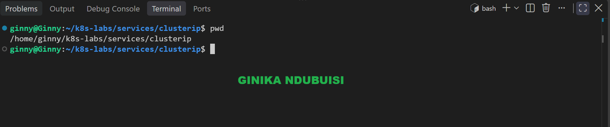

---

### Notes

**1. Why is it not reliable to communicate with an application using a Pod IP address?**

Pods are temporary. When a Pod is restarted elsewhere, replaced during a rolling update, or deleted and recreated by its ReplicaSet, the new Pod usually gets a different IP address.

**2. What Kubernetes resource provides a stable internal address for a group of Pods?**

A Kubernetes Service. It gives a group of Pods one stable IP address and DNS name, and it uses a label selector (like app=nginx) to find them. As Pods come and go, the Service keeps sending traffic to the current matching Pods, and it only includes Pods that are Ready.

---

# Task 2 — Create a Healthy NGINX Deployment

## Goal

Create an NGINX Deployment with labels, readiness probes, and liveness probes that can act as the backend for a Service.

### Evidence

#### Screenshot 2 — Completed `00-nginx-deploy.yaml` manifest

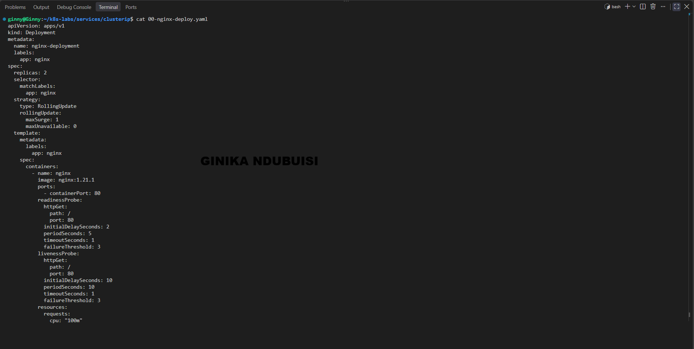

---

#### Screenshot 3 — Output showing successful rollout and two ready NGINX Pods

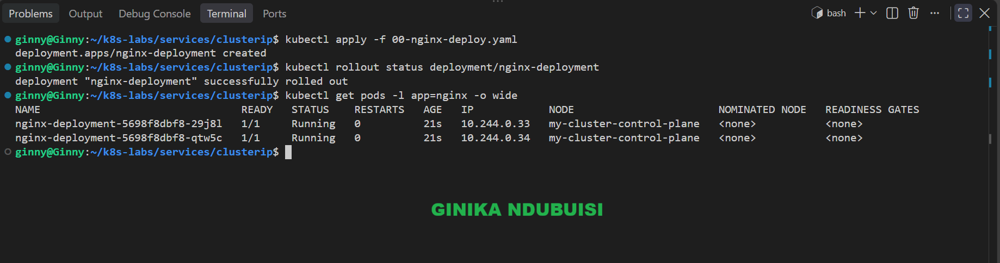

---

### Notes

**1. Which label will the Service use to find these Pods?**

app=nginx. The Service's selector matches this label, so any Pod with app=nginx becomes one of its backends.

**2. Why is readiness important before connecting Pods to a Service?**

A Service only sends traffic to Pods that are Ready. With a readiness probe, a Pod that is still starting or can't serve requests is kept out of the Service's endpoints until it passes the check, so users don't get errors or timeouts. Without a readiness probe, a Pod counts as Ready as soon as its container starts, and the Service could send traffic to it before NGINX can respond.

**3. What port does the NGINX container listen on?**

The NGINX container listens on port 80.

---

# Task 3 — Create a ClusterIP Service

## Goal

Create a stable internal Service that routes traffic to the NGINX Pods.

### Evidence

#### Screenshot 4 — Completed `01-nginx-svc-clusterip.yaml` manifest

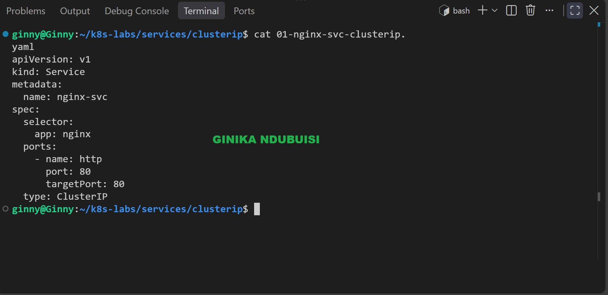

---

#### Screenshot 5 — Output showing the ClusterIP Service, endpoints, or EndpointSlices

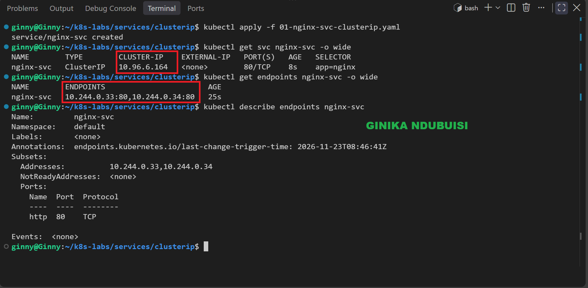

---

### Notes

**1. What is the purpose of a ClusterIP Service?**

A ClusterIP Service gives a group of Pods one stable internal IP address and DNS name that only works inside the cluster. In my lab, nginx-svc got the ClusterIP 10.96.6.164, and it spreads traffic across both NGINX Pods. Even when Pods are replaced and their IPs change, other applications in the cluster can keep using the same Service address.

**2. What is the difference between `port` and `targetPort`?**

`port` is the port the Service itself listens on, the one clients connect to on the ClusterIP. `targetPort`is the port on the Pod where the Service forwards that traffic, which is the container's port. In this lab both are 80: clients connect to 10.96.6.164:80, and the Service forwards to port 80 on each NGINX Pod.

**3. Why must the Service selector match the Pod labels?**

The selector is how the Service finds its Pods. Kubernetes only adds Pods whose labels match the selector as endpoints. My Service uses app=nginx, which matches the Pod labels, so both Pods showed up as endpoints. If the selector didn't match, the Service would have no endpoints and traffic to it would go nowhere.

**4. What information do EndpointSlices contain?**

EndpointSlices list the backend Pods behind a Service: each Pod's IP address, the port and protocol (here 80/TCP), and each endpoint's condition, such as whether it is Ready. They also record which Pod and node each endpoint belongs to. Kubernetes updates them automatically as Pods are added, removed, or change readiness.

---

# Task 4 — Access the Service from Inside the Cluster

## Goal

Create a client Pod and access the NGINX Service using DNS and its ClusterIP.

### Evidence

#### Screenshot 6 — Output showing the `tester` Pod running

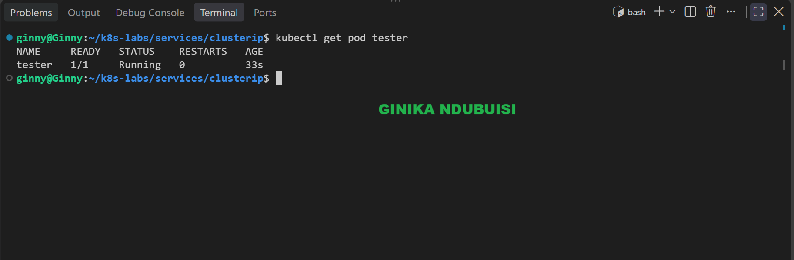

---

#### Screenshot 7 — Successful Service request using DNS name and ClusterIP

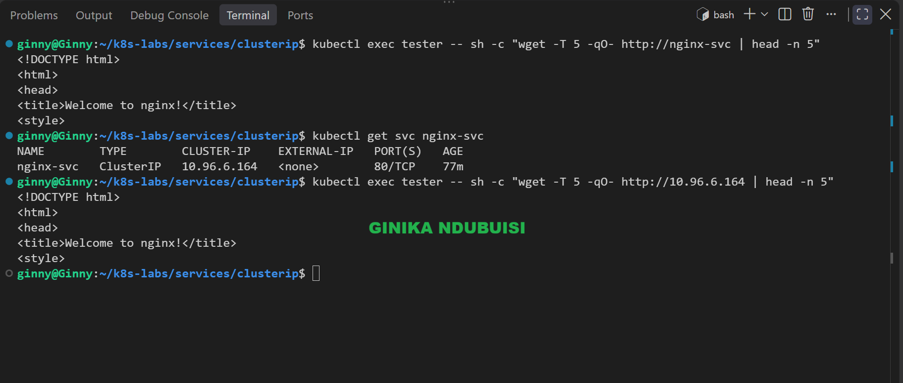

---

#### Screenshot 8 — Successful DNS lookup for the Service

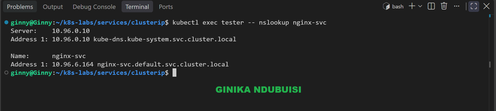

---

### Notes

**1. Why should an application use `nginx-svc` instead of a Pod IP address?**

Pod IPs change whenever Pods are restarted, replaced during a rollout, or recreated by the ReplicaSet, so a hard-coded Pod IP will eventually break. A Pod IP also reaches only one replica. The name nginx-svc stays the same, always points to the current Ready Pods, and spreads traffic across all of them.

**2. What does the DNS name `nginx-svc.default.svc.cluster.local` represent?**

It's the full internal DNS name of the Service. It breaks down as the Service name (nginx-svc), the namespace (default), the type of object (svc, for Service), and the cluster's domain (cluster.local). Cluster DNS resolves it to the Service's ClusterIP, 10.96.6.164. Pods in the same namespace can use just nginx-svc as a shortcut.

**3. Why can the client access the Service even if the backend Pod IPs change?**

The client only talks to the Service's stable name and ClusterIP, never to the Pods directly. Kubernetes watches for Pods matching app=nginx and updates the Service's endpoints automatically as Pods come and go. Traffic is always forwarded to whichever Pods are currently Ready, so the client doesn't need to know or care that the Pod IPs changed.

---

# Task 5 — Break and Restore the Label-Selector Contract

## Goal

Break the Service selector, observe that usable endpoints disappear, and then restore the correct selector.

### Evidence

#### Screenshot 9 — `02-nginx-svc-selector-broken.yaml` showing the incorrect selector

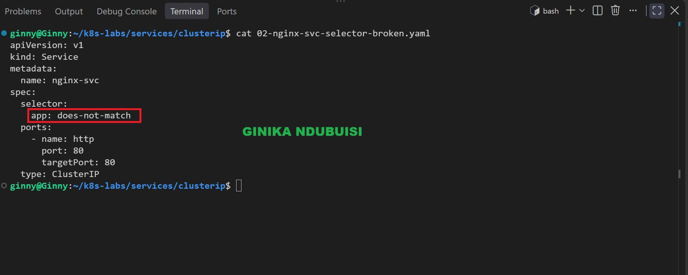

---

#### Screenshot 10 — Empty endpoints or EndpointSlice output after applying the broken selector

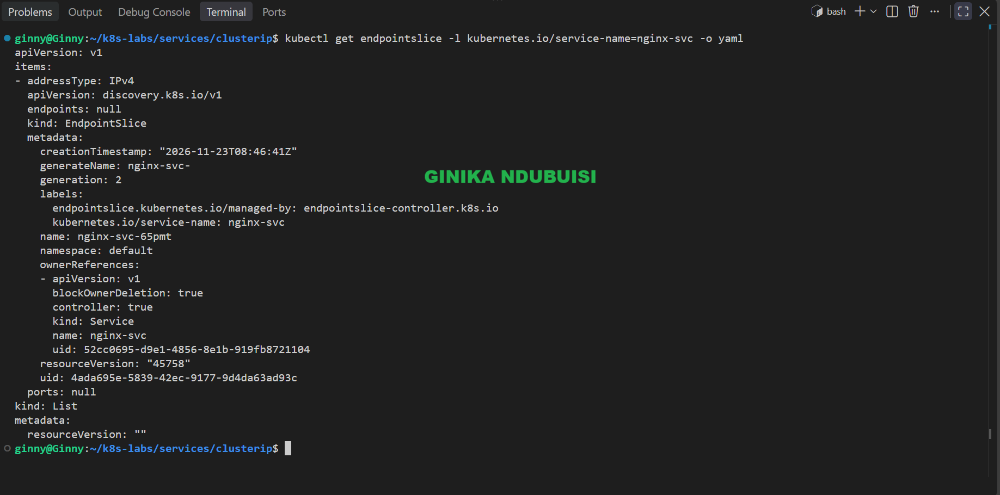

---

#### Screenshot 11 — Failed request output from the `tester` Pod

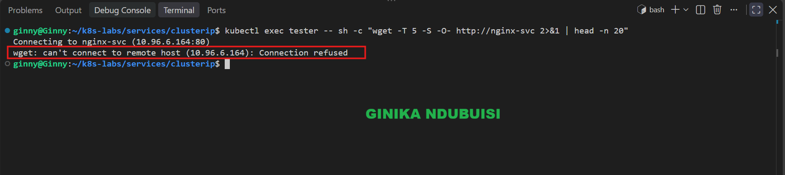

---

#### Screenshot 12 — Restored endpoints and successful Service request

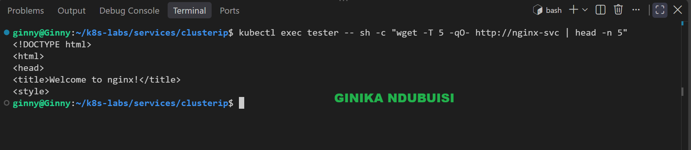

---

### Notes

**1. Why did the Service endpoints become empty?**

Add your answer here.

**2. What caused the request from the client Pod to fail?**

Add your answer here.

**3. How did you restore connectivity to the NGINX Pods?**

Add your answer here.

---

# Task 6 — Observe How Readiness Affects Service Routing

## Goal

Observe how a new Pod that fails readiness is excluded from ready Service backends while the existing healthy Pod continues serving traffic.

### Evidence

#### Screenshot 13 — Output showing the Deployment scaled to one ready Pod

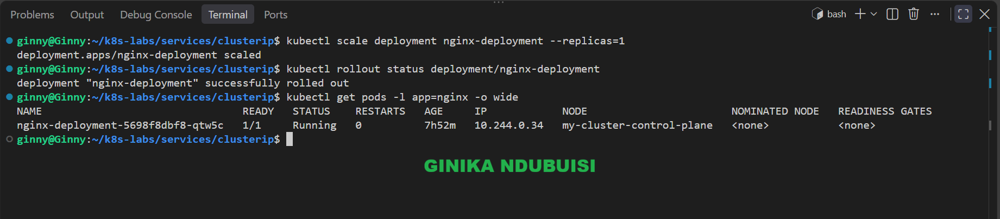

---

#### Screenshot 14 — Completed `03-readiness-broken.yaml` patch file

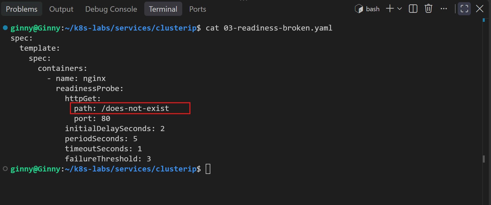

---

#### Screenshot 15 — Output showing the expected incomplete rollout or NotReady Pod

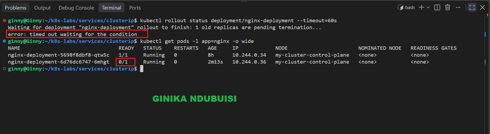

---

#### Screenshot 16 — EndpointSlice output showing the healthy Pod with `ready: true` and the new NotReady Pod with `ready: false`

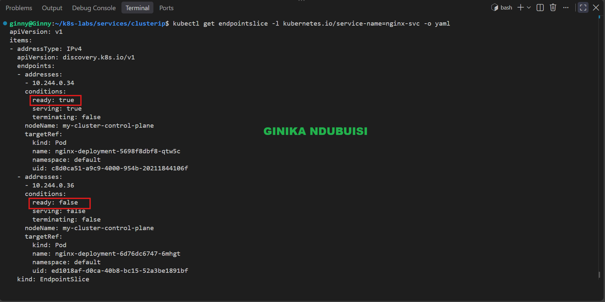

---

#### Screenshot 17 — Service EndpointSlice output showing ready backends after restoring the Deployment

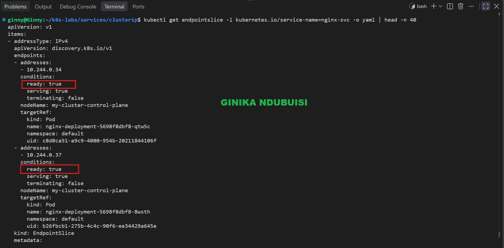

---

### Notes

**1. Why was the new NotReady Pod excluded from ready Service backends?**

The new Pod's readiness probe was checking /does-not-exist, a page NGINX doesn't have, so every check got a 404. Kubernetes marked the Pod NotReady (ready: false) and left it out of the Service's ready backends. The existing healthy Pod kept serving requests.

**2. What is the relationship between readiness probes and Service routing?**

The readiness probe decides whether a Pod can take traffic, and the Service follows that decision. Kubernetes updates the EndpointSlice based on each Pod's readiness, so the Service only sends traffic to Pods marked ready.

**3. Why does this behavior protect users from unhealthy application instances?**

Users never get sent to a Pod that can't handle their request. The healthy Pods keep serving traffic while the broken or still-starting Pod stays out of the way until it passes its readiness check.

---

# Task 7 — Share Your ClusterIP Service Learning on LinkedIn

## Goal

Share what you learned about ClusterIP Services, Kubernetes DNS, selectors, and readiness-aware Service routing.

### Evidence

#### Screenshot 18 — Published LinkedIn post

#### Linkedin post link

Paste your link here

---

# Submission Instructions

- Add all required screenshots numbered 1–18.
- Ensure your full name is visible in required screenshots.
- Use clear, readable screenshots showing the relevant manifest or output.
- Include the completed NGINX Deployment and ClusterIP Service manifests in your repository.
- Answer all Notes questions for Tasks 1–6 in your own words.
- Include evidence of the intentional failures and successful recovery.
- Do not expose tokens, passwords, kubeconfig files, account IDs, or other sensitive information.

---

# Completion Checklist

- [ ] Learning-cluster context confirmed and previous lab resources removed where applicable
- [ ] ClusterIP lab directory created (Screenshot 1)
- [ ] Healthy NGINX Deployment manifest completed (Screenshot 2)
- [ ] Successful rollout and two ready NGINX Pods verified (Screenshot 3)
- [ ] ClusterIP Service manifest completed (Screenshot 4)
- [ ] Service and backend endpoints or EndpointSlices verified (Screenshot 5)
- [ ] Client Pod created and running (Screenshot 6)
- [ ] Service accessed using DNS name and ClusterIP (Screenshot 7)
- [ ] Service DNS resolution verified (Screenshot 8)
- [ ] Broken selector manifest created (Screenshot 9)
- [ ] Empty endpoints observed (Screenshot 10)
- [ ] Failed Service request captured (Screenshot 11)
- [ ] Original selector restored and connectivity verified (Screenshot 12)
- [ ] Deployment scaled to one ready Pod (Screenshot 13)
- [ ] Broken readiness patch created (Screenshot 14)
- [ ] Incomplete rollout or NotReady Pod observed (Screenshot 15)
- [ ] Readiness effect on Service backends verified (Screenshot 16)
- [ ] Deployment restored and ready Service backends verified (Screenshot 17)
- [ ] LinkedIn post published (Screenshot 18)
- [ ] Notes for Tasks 1–6 completed
- [ ] Required manifests included
- [ ] All required screenshots are clear and readable
- [ ] No sensitive data exposed

---

## 📌 About DMI & CloudAdvisory

DevOps Micro Internship (DMI) is a project-based DevOps program run by Pravin Mishra (The CloudAdvisory) focused on real-world execution, systems thinking, and career readiness.

It helps learners build strong DevOps foundations with hands-on experience.

---

## 📌 Resources

- 🌐 DMI Official Website: https://dmi.pravinmishra.com?utm_source=github&utm_medium=readme  
- 🎓 University: https://university.pravinmishra.com?utm_source=github&utm_medium=readme  
- 💬 Discord Community: https://discord.pravinmishra.com?utm_source=github&utm_medium=readme  
- 📝 Blog: https://dmi.pravinmishra.com/blog?utm_source=github&utm_medium=readme  
- ▶️ YouTube Playlist: https://www.youtube.com/playlist?list=PLFeSNDtI4Cho  
- 🔗 Pravin Mishra (LinkedIn): https://www.linkedin.com/in/pravin-mishra-aws-trainer/  
- 🏢 CloudAdvisory (LinkedIn): https://www.linkedin.com/company/thecloudadvisory/

---

*This submission is part of DevOps Micro Internship (DMI) — Agentic AI Track.*
