# Assignment 8 — Kubernetes Services (NodePort)

Part of the DevOps Micro Internship (DMI) with Agentic AI

---

## Purpose

Create a healthy NGINX Deployment, expose it through a NodePort Service, test access using a node IP and NodePort, and observe how the Service behaves when a backend Pod is replaced.

---

# Task 1 — Set Up Your Lab Directory

## Goal

Create and enter a dedicated directory for the NodePort Service lab.

### Evidence

#### Screenshot 1 — Terminal showing that you are working inside `~/k8s-labs/services/nodeport`

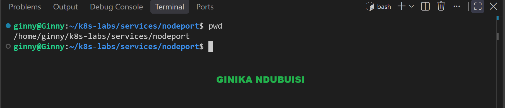

### Notes

**1. What is the difference between ClusterIP and NodePort?**

A ClusterIP Service can only be reached from inside the cluster. It gives the Pods a stable internal IP and DNS name that other Pods can use. A NodePort Service builds on top of that: it still gets a ClusterIP, but it also opens the same port (in the range 30000–32767 by default) on every node, so the Service can be reached from outside the cluster too.

**2. What does a NodePort Service allow users to do?**

It lets users outside the cluster reach the application by sending requests to any node's IP address on the NodePort.

---

# Task 2 — Create a Healthy NGINX Deployment

## Goal

Create a healthy NGINX Deployment that can act as the backend for the NodePort Service.

### Evidence

#### Screenshot 2 — Completed `00-nginx-deploy.yaml` manifest

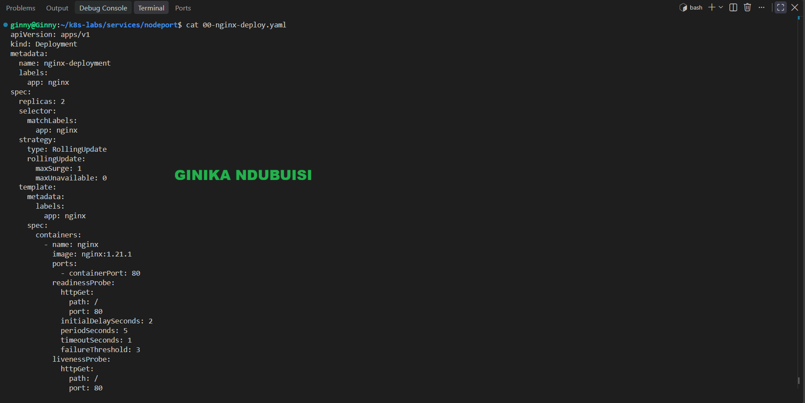

---

#### Screenshot 3 — Output showing successful rollout and two ready NGINX Pods

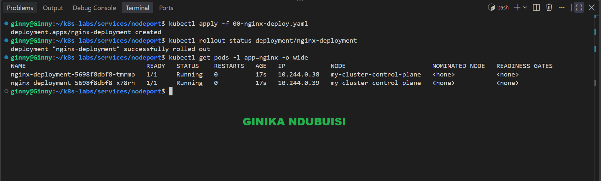

### Notes

**1. Which label will the NodePort Service use to find the NGINX Pods?**

The NodePort Service will use the label app=nginx to find the NGINX Pods. Its selector is set to app=nginx, so any Pod with this label is added as a backend.

**2. Why must the Pods be ready before they can receive Service traffic?**

The Pods must be ready because a Service only sends traffic to Pods that have passed their readiness check. If a Pod is still starting or is not able to serve requests, Kubernetes keeps it out of the Service's endpoints so users do not receive errors or timeouts. Once the Pod becomes ready, it is added to the endpoints and starts receiving traffic through the NodePort.

**3. What port does the NGINX container listen on?**

The NGINX container listens on port 80. This is set as containerPort: 80 in the Deployment, and the NodePort Service uses targetPort: 80 to forward traffic to it.

---

# Task 3 — Create the NodePort Service

## Goal

Create a NodePort Service that exposes the NGINX application through a port on every cluster node.

### Evidence

#### Screenshot 4 — Completed `01-nginx-svc-nodeport.yaml` manifest

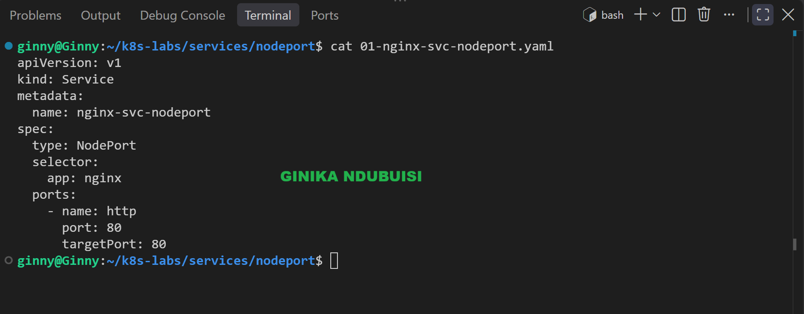

---

#### Screenshot 5 — Output showing the NodePort Service and its endpoints or EndpointSlices

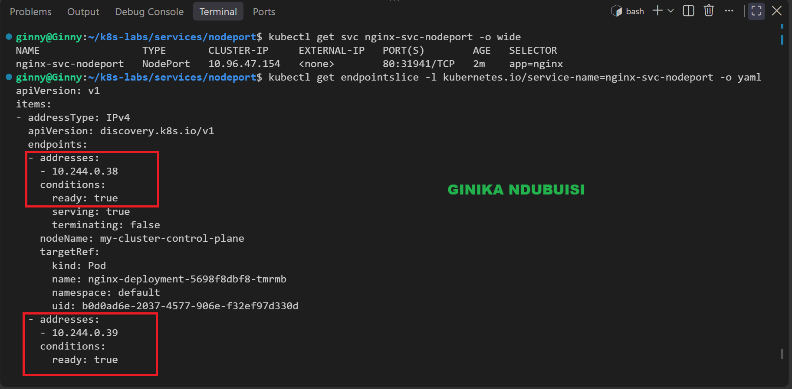
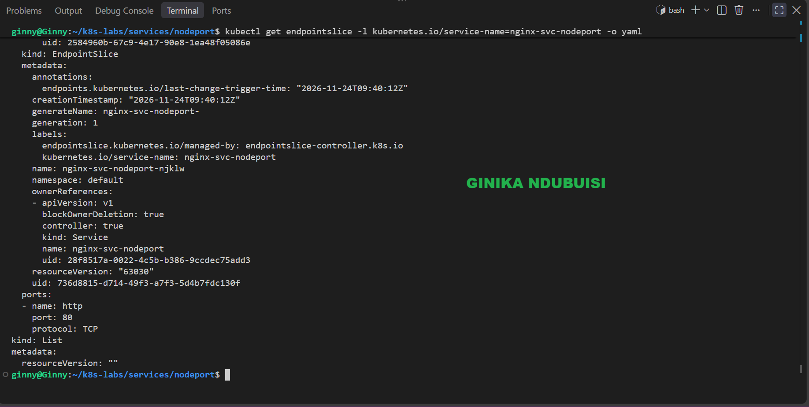

### Notes

**1. What is the purpose of `type: NodePort`?**

The purpose of type: NodePort is to make the Service reachable from outside the cluster. Kubernetes opens the same port on every node, and any request sent to a node's IP on that port is forwarded to the Service and then to one of the ready NGINX Pods. The Service still gets a ClusterIP, so it can also be reached from inside the cluster.

**2. What is the difference between `port`, `targetPort`, and `nodePort`?**

The port is the port the Service listens on inside the cluster, on its ClusterIP. The targetPort is the port on the Pod where the Service forwards traffic, which is port 80 for the NGINX container. The nodePort is the port opened on every node so that traffic from outside the cluster can reach the Service. The traffic flow is nodePort → port → targetPort.

**3. What NodePort was assigned or selected in your environment?**

The NodePort assigned in my environment is 31941. Kubernetes chose it automatically from the default 30000–32767 range.

**4. Why do Service endpoints need ready Pods?**

Service endpoints need ready Pods because a Service only sends traffic to Pods that have passed their readiness check. In my EndpointSlice, both NGINX Pods (10.244.0.38 and 10.244.0.39) show ready: true and serving: true, so the Service can route traffic to both of them.

---

# Task 4 — Find a Node IP and Test the NodePort

## Goal

Find a reachable node IP and access the NodePort Service.

### Evidence

#### Screenshot 6 — Output of `kubectl get nodes -o wide`

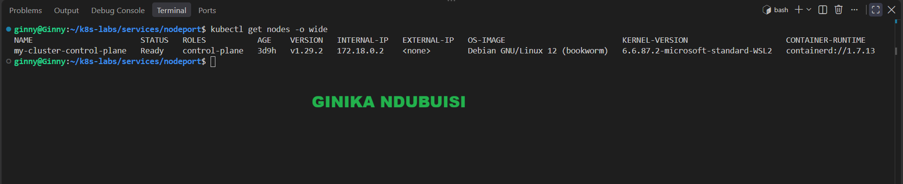

---

#### Screenshot 7 — Output showing the `tester` Pod running

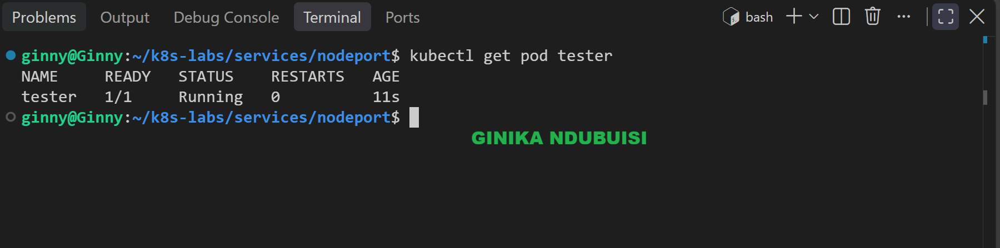

---

#### Screenshot 8 — Successful NodePort response from the laptop or the `tester` Pod

If neither route is supported by your environment, include the failed request output and ready endpoint evidence, and explain the limitation in your Notes.

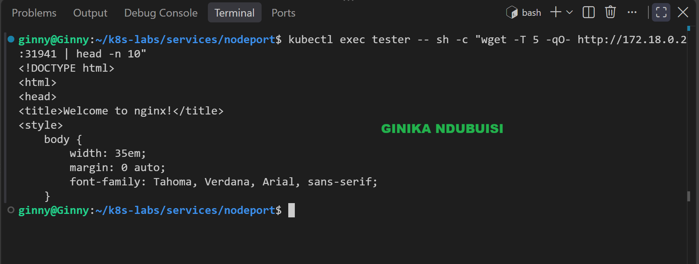

### Notes

**1. Which node IP and NodePort did you test?**

I tested node IP 172.18.0.2 with NodePort 31941. I got the node IP from kubectl get nodes -o wide, and the NodePort from kubectl get svc nginx-svc-nodeport, which showed 80:31941/TCP. I sent requests to http://172.18.0.2:31941.

**2. Was your laptop able to reach the NodePort directly? Explain your result.**

No. When I ran curl -I http://172.18.0.2:31941 from my WSL terminal, it failed with "Failed to connect to 172.18.0.2 port 31941 after 5002 ms: Timeout was reached". This happened because my kind cluster runs inside Docker, and the node IP 172.18.0.2 is on Docker's internal network, which my laptop cannot reach directly. The NodePort itself was working: when I sent the same request from inside the cluster using the tester Pod, wget http://172.18.0.2:31941 returned the NGINX welcome page.

**3. Why can external NodePort access behave differently in Minikube, kind, Docker Desktop, and cloud clusters?**

A NodePort can only be reached if your computer can reach the node's IP address, and each environment sets up its nodes differently. In kind, the nodes run inside Docker on a private network, so my laptop could not reach 172.18.0.2 and the request timed out. Other environments, like Minikube, Docker Desktop, or cloud clusters, may need a tunnel, use localhost, or need firewall rules opened before the NodePort works from outside.

---

# Task 5 — Optional: Test the Label-Selector Contract

## Goal

Break the Service selector, observe that usable endpoints disappear, and restore the correct selector.

Complete the Evidence and Notes below only if you attempted this optional task.

### Evidence

#### Screenshot 9 — `02-nginx-svc-selector-broken.yaml` showing the incorrect selector

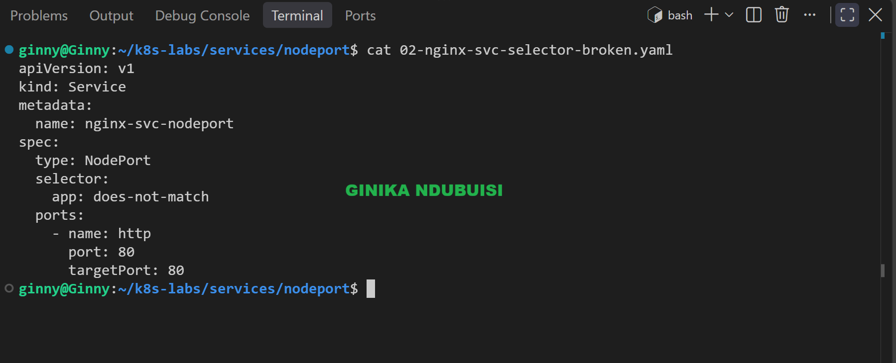

---

#### Screenshot 10 — Empty endpoints or EndpointSlice output after applying the broken selector

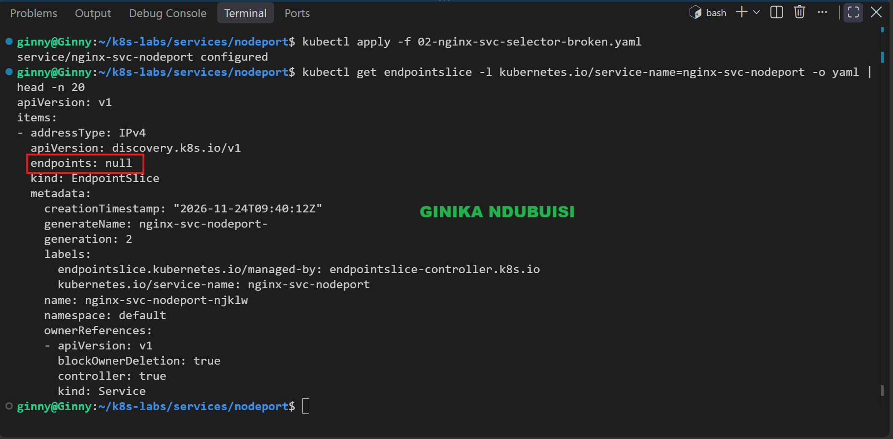

---

#### Screenshot 11 — Restored endpoints or EndpointSlices after applying the original Service manifest

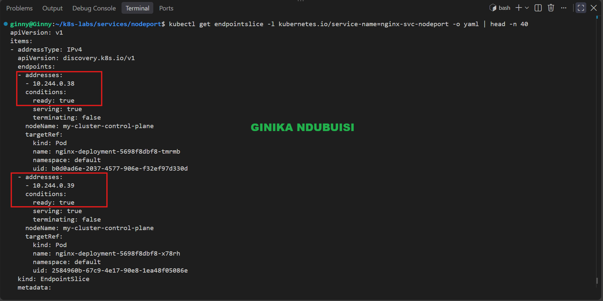

### Notes

**1. Why did the Service endpoints become empty?**

The Service endpoints became empty because I changed the Service selector from app: nginx to app: does-not-match. The NGINX Pods still had the label app=nginx, so no Pod matched the new selector. The Pods kept running at 1/1, but the EndpointSlice showed endpoints: null, which means the Service had no backends to send traffic to.

**2. Why is NodePort only useful when matching ready Pods exist?**

A NodePort is only the entry point. It accepts traffic on the node and passes it to the Service, but the Service still needs matching ready Pods to forward that traffic to.

**3. How did you restore the backend connectivity?**

I restored the backend connectivity by applying the working Service file, 01-nginx-svc-nodeport.yaml, which sets the selector back to app: nginx. The Service matched the NGINX Pods again, and the EndpointSlice showed both Pod addresses with ready: true.

---

# Task 6 — Observe Resilience During Pod Churn

## Goal

Delete one NGINX Pod and observe its replacement while the Service continues routing traffic to available Pods.

### Evidence

#### Screenshot 12 — Output of the Pod deletion command

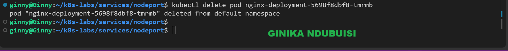

---

#### Screenshot 13 — Output showing the replacement Pod and two running, ready Pods

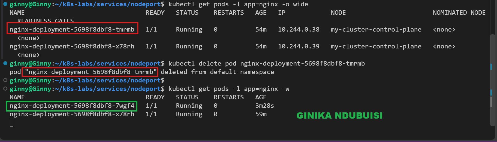

### Notes

**1. What happened after you deleted one Pod?**

After I deleted nginx-deployment-5698f8dbf8-tmrmb (10.244.0.38), Kubernetes immediately created a new Pod to replace it. The new Pod got a new name, nginx-deployment-5698f8dbf8-7wgf4, and a new IP address, 10.244.0.41. The other Pod, nginx-deployment-5698f8dbf8-x78rh (10.244.0.39), kept running the whole time, and the Deployment returned to 2 ready Pods.

**2. Which Kubernetes resource created the replacement Pod?**

The ReplicaSet created the replacement Pod. The Deployment manages the ReplicaSet, and the ReplicaSet's job is to keep 2 Pods running. When it saw only 1 Pod left, it created a new one to get back to the desired count. That's why the new Pod's name starts with the same ReplicaSet prefix, nginx-deployment-5698f8dbf8.

**3. Why can the NodePort Service continue working during Pod churn?**

The NodePort Service finds its Pods using the label app=nginx, not fixed Pod IPs. When the old Pod was deleted, Kubernetes removed 10.244.0.38 from the EndpointSlice, and when the new Pod became ready, it added 10.244.0.41 automatically. The remaining Pod, 10.244.0.39, kept serving traffic in the meantime, so requests to port 31941 continued to work without any change to the Service.

---

# Task 7 — Share Your NodePort Learning on LinkedIn

## Goal

Share what you learned about NodePort Services, backend Pods, and network access in your Kubernetes environment.

### Evidence

#### Screenshot 14 — Published LinkedIn post about your NodePort Service lab

#### Linkedin post link

Add your Linkdin post link.

---

# Submission Instructions

- Include the completed YAML manifests created during the lab.
- Add all required screenshots: Screenshots 1–8 and 12–14.
- Include Screenshots 9–11 only if you attempted optional Task 5.
- Complete the Notes for Tasks 1–4 and Task 6.
- Complete Task 5 Notes only if you attempted that task.
- Use clear, readable screenshots showing the relevant commands and outputs.
- Ensure your full name is visible in the required screenshots.
- If NodePort access is restricted by your environment, include the failed request output, ready endpoint evidence, and an explanation.
- Do not expose passwords, access tokens, private keys, kubeconfig contents, or account IDs.

---

# Completion Checklist

- [ ] Created and entered `~/k8s-labs/services/nodeport` (Screenshot 1)
- [ ] Created and applied the NGINX Deployment manifest (Screenshot 2)
- [ ] Confirmed successful rollout and two ready NGINX Pods (Screenshot 3)
- [ ] Created the NodePort Service manifest (Screenshot 4)
- [ ] Verified the Service and its endpoints or EndpointSlices (Screenshot 5)
- [ ] Recorded the assigned or selected NodePort
- [ ] Identified a node IP (Screenshot 6)
- [ ] Confirmed that the `tester` Pod is running (Screenshot 7)
- [ ] Tested NodePort access, or documented the environment limitation with evidence (Screenshot 8)
- [ ] Optional: Tested and restored the Service selector (Screenshots 9–11)
- [ ] Deleted one NGINX Pod (Screenshot 12)
- [ ] Confirmed the replacement Pod and two running, ready Pods (Screenshot 13)
- [ ] Completed all required Notes
- [ ] Published the LinkedIn post (Screenshot 14)
- [ ] No sensitive data exposed

---

## 📌 About DMI & CloudAdvisory

DevOps Micro Internship (DMI) is a project-based DevOps program run by Pravin Mishra (The CloudAdvisory) focused on real-world execution, systems thinking, and career readiness.

It helps learners build strong DevOps foundations with hands-on experience.

---

## 📌 Resources

- 🌐 DMI Official Website: https://dmi.pravinmishra.com?utm_source=github&utm_medium=readme  
- 🎓 University: https://university.pravinmishra.com?utm_source=github&utm_medium=readme  
- 💬 Discord Community: https://discord.pravinmishra.com?utm_source=github&utm_medium=readme  
- 📝 Blog: https://dmi.pravinmishra.com/blog?utm_source=github&utm_medium=readme  
- ▶️ YouTube Playlist: https://www.youtube.com/playlist?list=PLFeSNDtI4Cho  
- 🔗 Pravin Mishra (LinkedIn): https://www.linkedin.com/in/pravin-mishra-aws-trainer/  
- 🏢 CloudAdvisory (LinkedIn): https://www.linkedin.com/company/thecloudadvisory/

---

*This submission is part of DevOps Micro Internship (DMI) — Agentic AI Track.*
