# Assignment 09 — Kubernetes Services: LoadBalancer on AKS

Part of the DevOps Micro Internship (DMI) with Agentic AI

---

## Purpose

Deploy a healthy NGINX application to Azure Kubernetes Service (AKS), expose it publicly using a LoadBalancer Service, observe readiness behavior, and scale the application behind the same public endpoint.

---

# Task 1 — Create or Connect to an AKS Cluster

## Goal

Create a small AKS cluster for this lab, or connect to an existing approved AKS lab cluster.

### Evidence

#### Screenshot 1 — Output of `kubectl get nodes` showing ready AKS node(s)

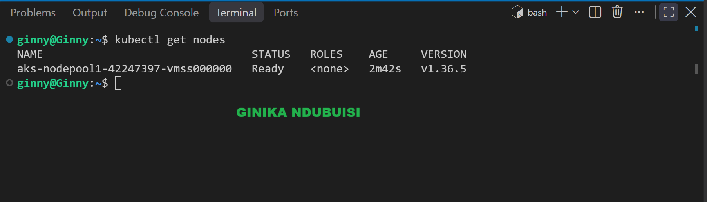

### Notes

**1. Why does this lab use a cloud-capable Kubernetes environment such as AKS for the LoadBalancer Service?**

This lab uses AKS because a LoadBalancer Service needs a cloud provider to create a real load balancer with a public IP. In a local cluster like kind, the Service would stay at EXTERNAL-IP <pending> because there is no cloud integration to provision one. AKS is connected to Azure, so Kubernetes can ask Azure to create the load balancer automatically.

**2. What Azure resources can Kubernetes provision when a LoadBalancer Service is created?**

When a LoadBalancer Service is created, AKS can provision an Azure Load Balancer (or add rules to the existing one), a public IP address, load-balancing rules and health probes for the Service port, and network security group rules that allow traffic to reach the nodes.

**3. Why is it important to delete unused AKS resources after the lab?**

It is important because AKS resources keep costing money while they exist, even when nothing is using them. The node VMs, public IP, load balancer and disks are all billed. Deleting them after capturing the evidence avoids unexpected charges and keeps the Azure subscription clean.

---

# Task 2 — Set Up Your Lab Directory

## Goal

Create and enter a dedicated directory for the LoadBalancer Service manifests.

### Evidence

#### Screenshot 2 — Terminal showing the output of `pwd` confirming that you are working inside `~/k8s-labs/services/loadbalancer`

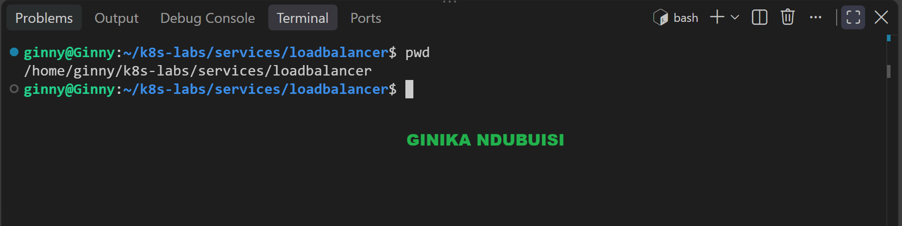

### Notes

**1. Why is it useful to keep Kubernetes manifests organized in dedicated directories?**

Keeping manifests in dedicated directories makes it easy to find, apply and clean up the files for each lab. It keeps different labs from mixing together, so I don't accidentally apply the wrong file. It also makes the work easier to review and push to Git.

**2. What are the names of the main Deployment and LoadBalancer Service YAML files you will create in this assignment?**

The main Deployment file is 00-nginx-deploy.yaml and the LoadBalancer Service file is 01-nginx-svc-loadbalancer.yaml. I will also create 02-readiness-broken.yaml as the patch file for breaking readiness in Task 5.

---

# Task 3 — Deploy a Healthy NGINX Application

## Goal

Create a healthy NGINX Deployment with readiness and liveness probes.

### Evidence

#### Screenshot 3 — Completed `00-nginx-deploy.yaml` manifest

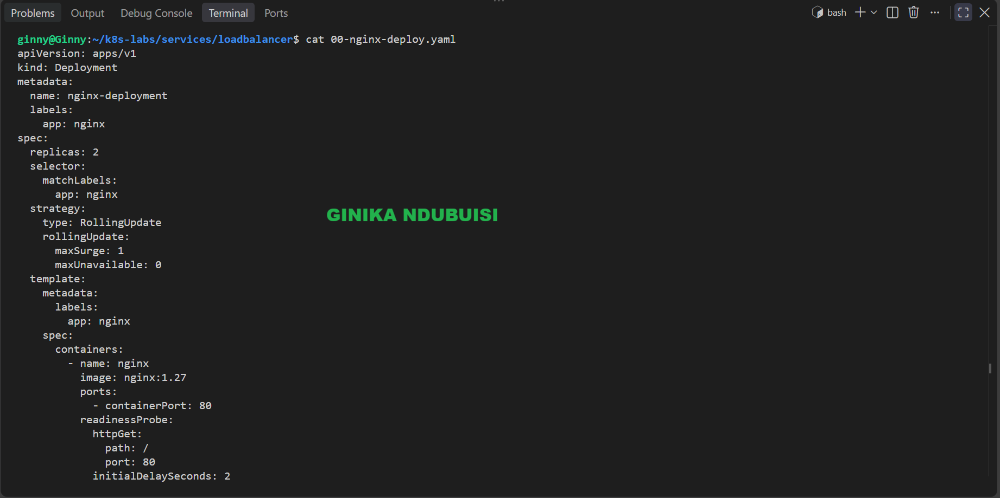
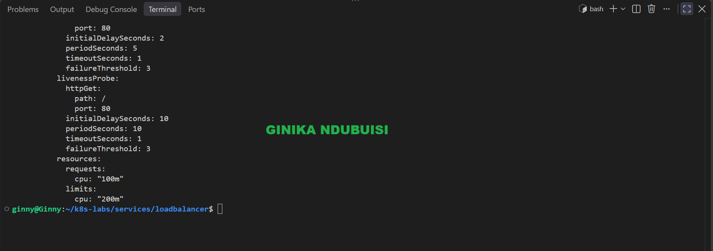

---

#### Screenshot 4 — Output showing successful rollout and two ready NGINX Pods

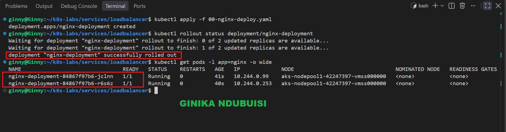

### Notes

**1. Why must Pods be ready before they should receive public traffic?**

Pods must be ready because a Pod that is still starting or not working properly cannot handle requests. If public traffic reached it too early, users would get errors or timeouts. Waiting for readiness makes sure users only reach Pods that can respond.

**2. What is the role of the readiness probe in this Deployment?**

The readiness probe checks whether each NGINX Pod can accept traffic. Until the probe succeeds, Kubernetes marks the Pod NotReady and keeps it out of the Service's ready endpoints. It also protects rollouts, because Kubernetes waits for new Pods to become ready before removing old ones.

**3. What is the role of the liveness probe in this Deployment?**

The liveness probe checks whether the NGINX container is still healthy. If it fails several times in a row, Kubernetes restarts the container automatically. It does not decide whether the Pod receives traffic; that is the readiness probe's job.

---

# Task 4 — Create and Test the LoadBalancer Service

## Goal

Create a public LoadBalancer Service and verify that the NGINX application is reachable from the internet.

### Evidence

#### Screenshot 5 — Completed `01-nginx-svc-loadbalancer.yaml` manifest

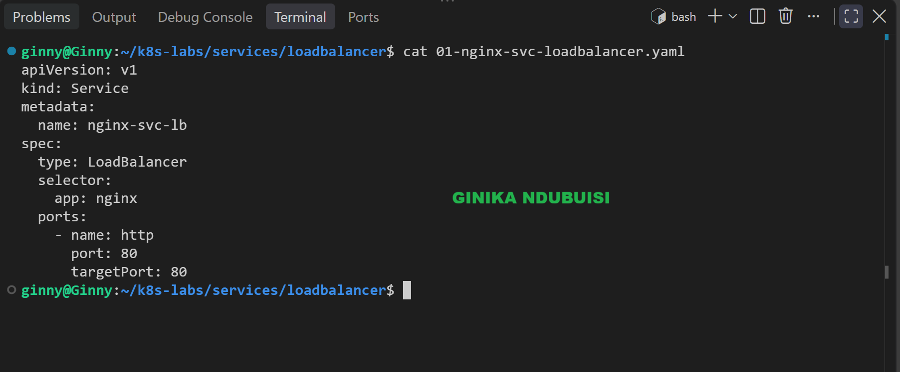

---

#### Screenshot 6 — Output showing the Service with an assigned EXTERNAL-IP

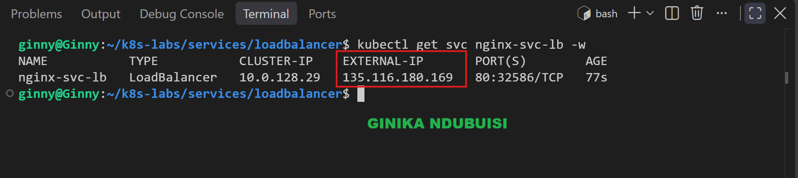

---

#### Screenshot 7 — Successful curl output from the public IP

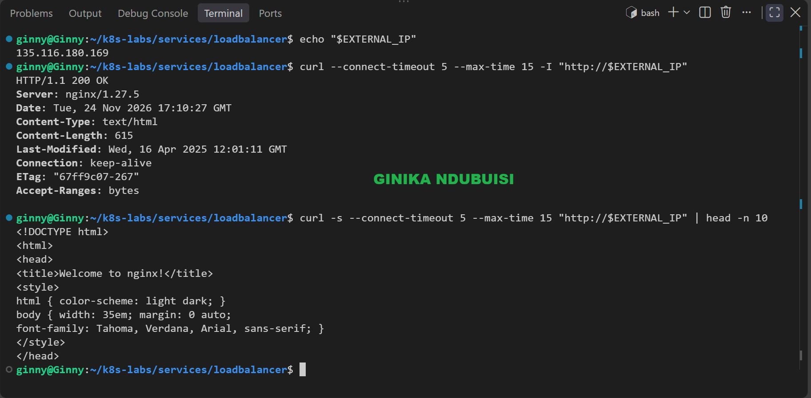

### Notes

**1. What does `type: LoadBalancer` instruct AKS to do?**

`type: LoadBalancer` tells AKS to expose the Service to the internet. AKS asks Azure to create an Azure Load Balancer rule and a public IP for the Service, then forwards traffic from that IP to the NGINX Pods. The Service still gets a ClusterIP and NodePort underneath.

**2. What public IP was assigned to your Service?**

Azure assigned the public IP **135.116.180.169** to the `nginx-svc-lb` Service. It appeared in the EXTERNAL-IP column of `kubectl get svc nginx-svc-lb` after it changed from `<pending>`. I saved it with `kubectl get svc nginx-svc-lb -o jsonpath='{.status.loadBalancer.ingress[0].ip}'` and used it to test public access with `curl`, which returned `HTTP/1.1 200 OK` and the NGINX welcome page.

**3. How does the public request eventually reach the NGINX Pods?**

The request goes to the public IP on the Azure Load Balancer. The load balancer sends it to one of the AKS nodes, and Kubernetes forwards it through the Service to one of the ready NGINX Pods on port 80. The Service only uses Pods that match the app=nginx label and are ready.

**4. Why should you wait for EXTERNAL-IP before testing the Service?**

Azure needs time to create the load balancer rule and public IP. While the EXTERNAL-IP shows <pending>, there is no public address to send requests to, so a curl test would fail even though nothing is wrong.

---

# Task 5 — Observe How Readiness Protects Public Traffic

## Goal

Intentionally break readiness and observe how Kubernetes excludes unready Pods from ready Service backends while existing healthy Pods continue serving public traffic.

### Evidence

#### Screenshot 8 — Completed `02-readiness-broken.yaml` patch file

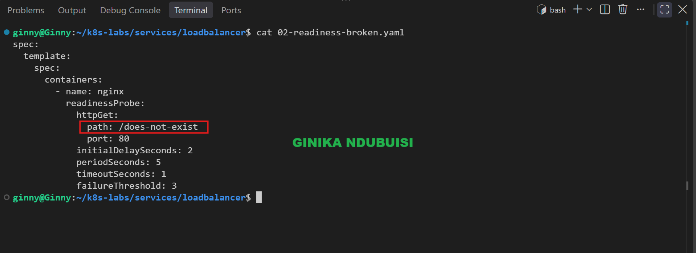

---

#### Screenshot 9 — Output showing the expected incomplete rollout or readiness failure

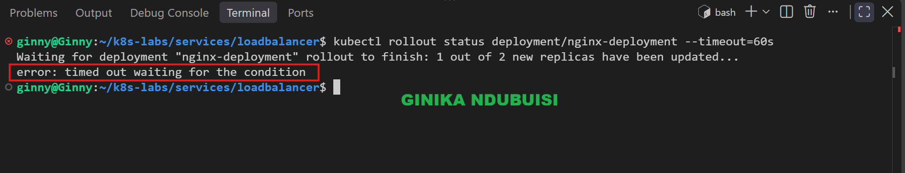

---

#### Screenshot 10 — EndpointSlice output showing ready healthy backends and the effect of the readiness failure

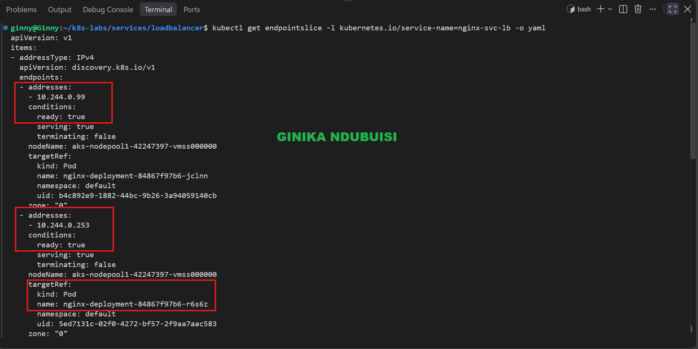
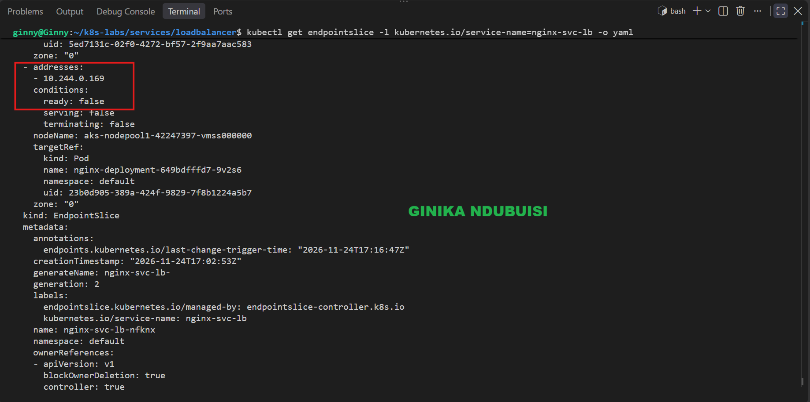

---

#### Screenshot 11 — Successful public curl response after recovery

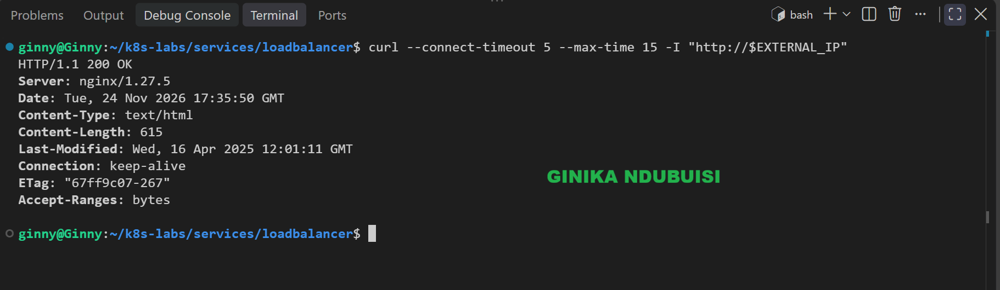

### Notes

**1. Why did the rollout not complete?**

The rollout didn't complete because the new Pod's readiness probe checked `/does-not-exist`, which returns 404, so the Pod never became ready. With `maxUnavailable: 0`, Kubernetes could not remove the old Pods until a new one was ready, so the rollout stalled and timed out.

**2. Why can the public endpoint still work while new Pods fail readiness?**

The public endpoint still worked because the two original Pods stayed running and ready (`ready: true`), and the Service only sends traffic to ready Pods. The broken Pod was marked `ready: false` and got no traffic.

**3. What would happen if Kubernetes routed traffic to Pods before they were ready?**

Users would get errors or timeouts, because their requests would reach Pods that are not ready to serve.

**4. How did you restore the Deployment successfully?**

I restored it by running `kubectl apply -f 00-nginx-deploy.yaml`, which set the readiness probe back to `/`. The new Pods became ready, the broken Pod was removed, and `curl` to the public IP returned `200 OK`.

---

# Task 6 — Scale the Deployment Behind the Load Balancer

## Goal

Scale the NGINX Deployment and confirm that more ready Pods become available behind the same public endpoint.

### Evidence

#### Screenshot 12 — Two ready NGINX Pods verified initially; four ready Pods verified after scaling

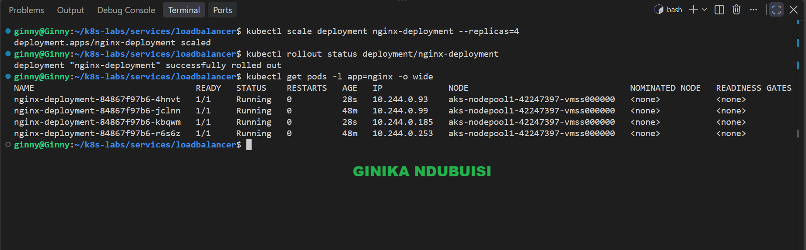

---

#### Screenshot 13 — Successful public curl response after scaling

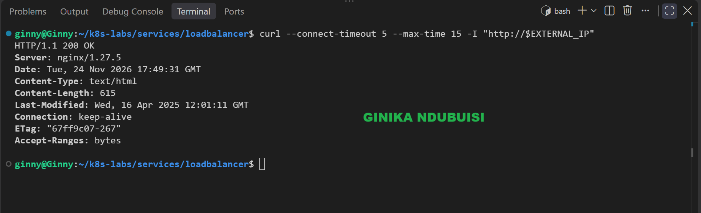

### Notes

**1. What changed after scaling the Deployment from two to four replicas?**

After scaling, Kubernetes created two more NGINX Pods, so there were four Pods at `1/1 Running`. The new Pods passed readiness and were added to the EndpointSlice with `ready: true`, so the Service now spreads traffic across four Pods instead of two.

**2. Did the public IP change after scaling? Explain why or why not.**

No, the public IP stayed 135.116.180.169. The IP belongs to the Service and the Azure Load Balancer, not to the Pods. Scaling only added Pods behind the Service.

**3. Why does scaling behind a LoadBalancer Service not require users to change the URL or IP they use?**

Users don't need a new URL or IP because they connect to the Service's public IP, not to individual Pods. The Service selector (`app: nginx`) picks up new Pods automatically and routes traffic to them, so the address users connect to stays the same.

---

# Task 7 — Share Your LoadBalancer Lab on LinkedIn

## Goal

Share what you learned about exposing an NGINX application publicly through a LoadBalancer Service on AKS.

### Evidence

#### Screenshot 14 — Published LinkedIn post about your LoadBalancer lab on AKS

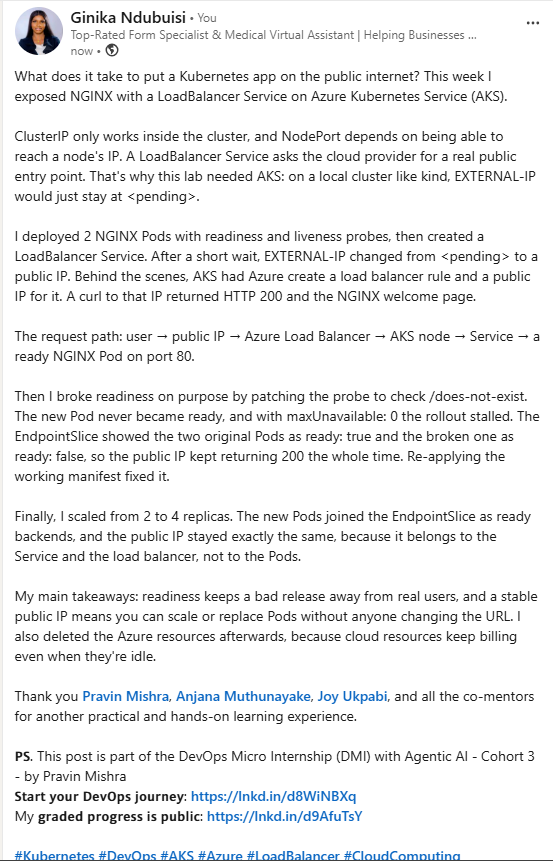

#### LinkedIn post link

https://www.linkedin.com/posts/ginikandubuisi_kubernetes-devops-aks-share-7531700327843135488-iwMb/?utm_source=share&utm_medium=member_desktop&rcm=ACoAAD6T0TgBum59kWGrvQdH9mZyCcgf18-giQo

---

# Submission Instructions

- Include the completed YAML files:
  - `00-nginx-deploy.yaml`
  - `01-nginx-svc-loadbalancer.yaml`
  - `02-readiness-broken.yaml`
- Add all required screenshots, numbered 1–14, under their corresponding Evidence sections.
- Use clear, readable screenshots showing the relevant commands, configuration, and outputs.
- Ensure your full name is visible in the required screenshots.
- Complete the Notes for Tasks 1–6 in your own words.
- Capture all required evidence before cleaning up Azure resources.
- Plan or complete Azure cleanup according to your lab ownership and reuse arrangements.
- Do not expose passwords, tokens, private keys, cluster credentials, kubeconfig contents, subscription IDs, account IDs, or infrastructure details you are not permitted to share.

---

# Completion Checklist

- [ ] Created or connected to an approved AKS lab cluster
- [ ] Confirmed ready AKS node(s) (Screenshot 1)
- [ ] Created and entered the LoadBalancer lab directory (Screenshot 2)
- [ ] Created the NGINX Deployment manifest (Screenshot 3)
- [ ] Verified successful rollout and two ready NGINX Pods initially (Screenshot 4)
- [ ] Created the LoadBalancer Service manifest (Screenshot 5)
- [ ] Verified the assigned external IP (Screenshot 6)
- [ ] Verified successful public access using curl (Screenshot 7)
- [ ] Created the broken readiness patch (Screenshot 8)
- [ ] Observed the expected incomplete rollout or readiness failure (Screenshot 9)
- [ ] Inspected EndpointSlices during the readiness failure (Screenshot 10)
- [ ] Restored the healthy Deployment and verified public access (Screenshot 11)
- [ ] Scaled the Deployment to four ready Pods and verified updated Service backends (Screenshot 12)
- [ ] Verified public access after scaling (Screenshot 13)
- [ ] Completed the Notes for Tasks 1–6
- [ ] Published the LinkedIn post (Screenshot 14)
- [ ] Included all required YAML files and screenshots
- [ ] Planned or completed Azure cleanup
- [ ] No sensitive data exposed

---

## 📌 About DMI & CloudAdvisory

DevOps Micro Internship (DMI) is a project-based DevOps program run by Pravin Mishra (The CloudAdvisory) focused on real-world execution, systems thinking, and career readiness.

It helps learners build strong DevOps foundations with hands-on experience.

---

## 📌 Resources

- 🌐 DMI Official Website: https://dmi.pravinmishra.com?utm_source=github&utm_medium=readme  
- 🎓 University: https://university.pravinmishra.com?utm_source=github&utm_medium=readme  
- 💬 Discord Community: https://discord.pravinmishra.com?utm_source=github&utm_medium=readme  
- 📝 Blog: https://dmi.pravinmishra.com/blog?utm_source=github&utm_medium=readme  
- ▶️ YouTube Playlist: https://www.youtube.com/playlist?list=PLFeSNDtI4Cho  
- 🔗 Pravin Mishra (LinkedIn): https://www.linkedin.com/in/pravin-mishra-aws-trainer/  
- 🏢 CloudAdvisory (LinkedIn): https://www.linkedin.com/company/thecloudadvisory/

---

*This submission is part of DevOps Micro Internship (DMI) — Agentic AI Track.*
