# Assignment 11 — AI-Assisted Kubernetes Incident Triage

Part of the DevOps Micro Internship (DMI) with Agentic AI

---

## Purpose

Configure a read-only Bash triage script for your Book Review App, connect it to Claude Code through `/k8s-triage`, simulate one controlled failure, recover the application manually, and verify recovery.

**Workflow: Gather → Analyze → Human Act → Verify**

---

## Submission Details

**Full Name:** GINIKA NDUBUISI

**Kubernetes Platform:** Add your platform here.

**Selected Workload:** Add the Deployment name here.

**Namespace:** Add the namespace here.

**GitHub Repository URL:** Add your project repository URL here.

**Simulated Incident:** Invalid image or broken readiness probe.

**Baseline Status:** HEALTHY or explained WARN.

**Recovery Status:** HEALTHY or explained WARN, with no FAIL.

---

# Task 1 — Discover the Application and Capture a Healthy Baseline

## Goal

Identify the actual application configuration and prove that the selected workload is healthy before incident simulation.

### Evidence

#### Screenshot 1 — Healthy Pods and ready Service backends

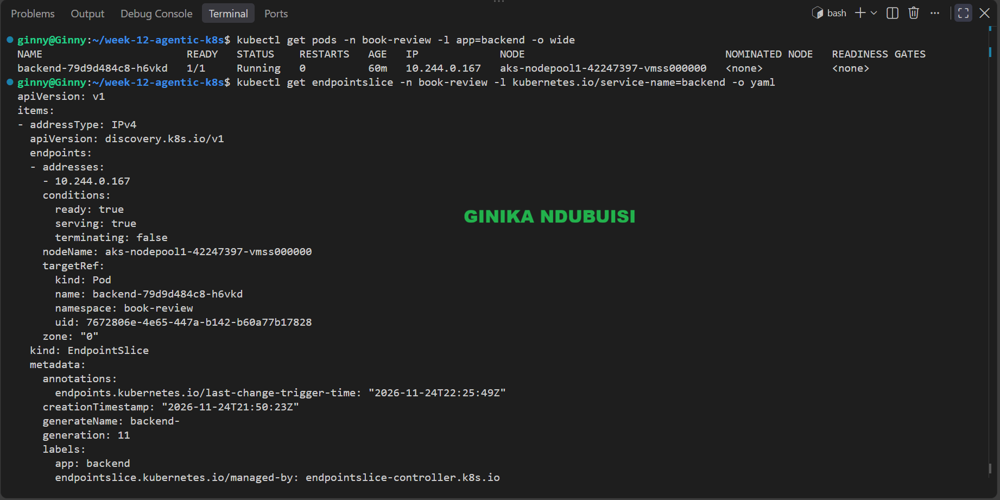

---

#### Screenshot 2 — Workspace directory structure

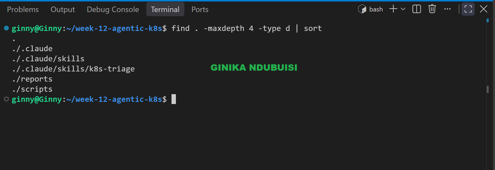

### Notes

**1. What proves the selected Pods are ready, not merely running?**

The READY column in `kubectl get pods -n book-review -l app=backend` shows `1/1`, which means the backend container has passed its readiness probe (`GET /` on port 3001). STATUS `Running` only means the container process has started. A Pod can be `Running` but show `0/1` if its readiness probe fails, and then it receives no Service traffic.

**2. What proves the Service has ready backends?**

The EndpointSlice for the `backend` Service lists the backend Pod's IP address with `conditions.ready: true`. The Service only sends traffic to endpoints marked ready, so this confirms that at least one healthy Pod is behind the Service.

**3. Why must the original image be recorded before incident simulation?**

The incident replaces the container image with a tag that doesn't exist. To recover, I have to set the image back to the exact working version, `iamginika/book-review-backend:v1`. Recording it first means I know the correct value to restore and don't have to guess or rely on memory during the incident.

---

# Task 2 — Configure CLAUDE.md

## Goal

Define the project configuration, incident workflow, and safety boundary for Claude Code.

### Evidence

#### Screenshot 3 — CLAUDE.md showing application configuration, workflow, safety rules, and output rules

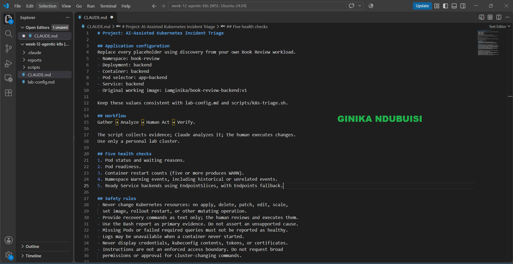
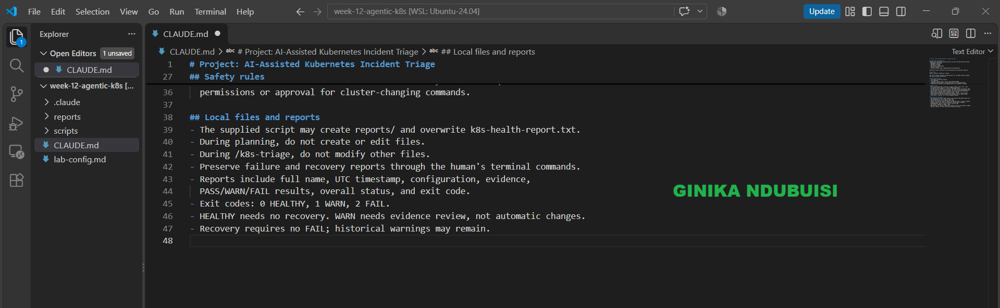

### Notes

**1. Why does Claude need project-specific cluster rules?**

Claude needs project-specific cluster rules to inspects the right namespace, Deployment, Pods and Service, and stays read-only and safe on this cluster.

**2. Why must a human execute recovery commands?**

A human must run recovery because it changes the live cluster, and the engineer is responsible for checking the command is correct before running it.

**3. Which rule prevents an unsupported diagnosis?**

The Safety rule: "Use the Bash report as primary evidence. Do not assert an unsupported cause."

---

# Task 3 — Plan the Read-Only Triage Workflow

## Goal

Ask Claude Code to explain the five health checks before running the supplied script.

### Evidence

#### Screenshot 4 — Claude Code showing the five-check read-only plan

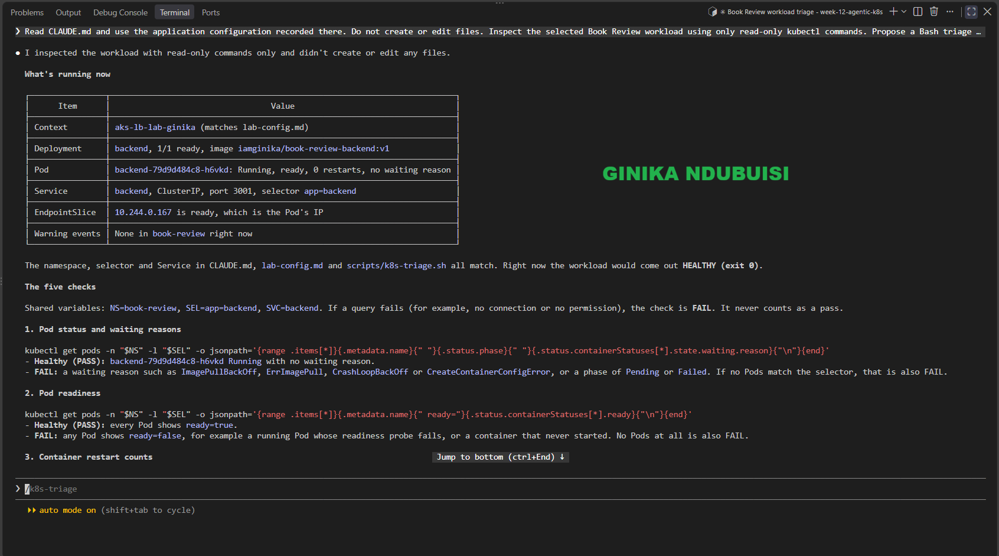
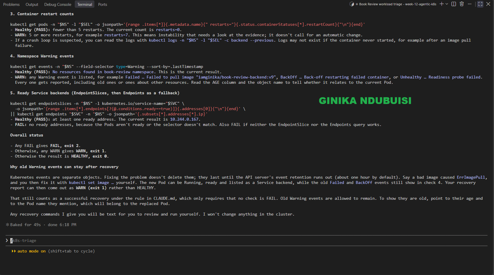

### Notes

**1. Which part represents the Gather phase?**

The read-only kubectl commands that collect Pod status, readiness, restart counts, Warning events and Service backends.

**2. How did you verify that Claude did not change anything?**

I reviewed Claude's tool activity in the session. It only ran read-only commands like `kubectl get` and `kubectl describe`, and it made no file edits or writes. No apply, delete, patch, scale or set image commands were executed.

**3. Why is planning before coding useful for incident triage?**

It confirms the checks are correct, read-only and aimed at the right workload before anything runs during a real incident.

---

# Task 4 — Configure and Validate the Bash Script

## Goal

Configure the supplied triage script for the selected workload and validate its syntax.

### Evidence

#### Screenshot 5 — Script configuration variables and checks array

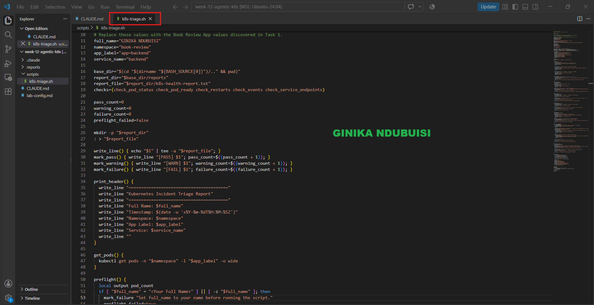

---

#### Screenshot 6 — Functions for status, readiness, restarts, events, and Service backends

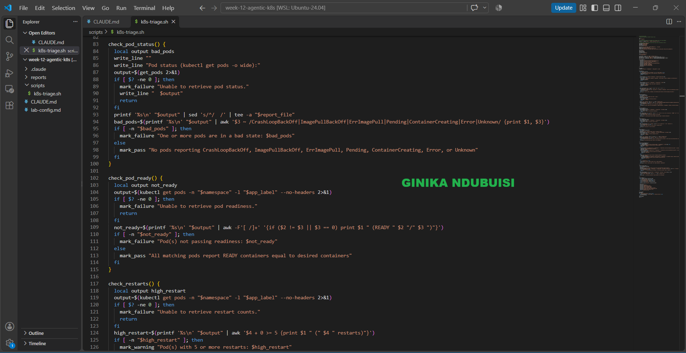

---

#### Screenshot 7 — Preflight, summary, and exit-code logic

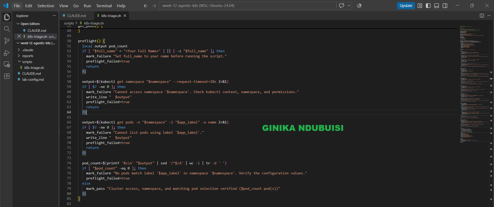
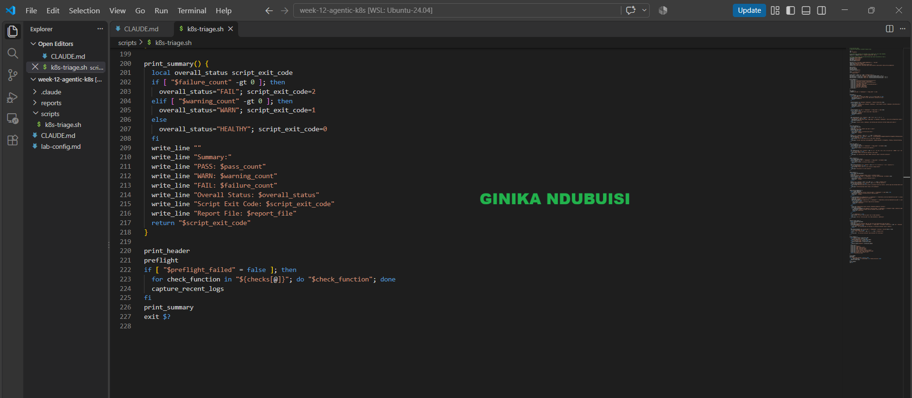

---

#### Screenshot 8 — Successful syntax validation and executable permission

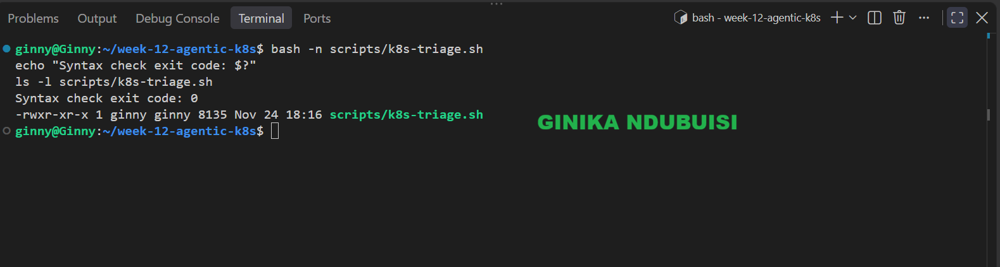

### Notes

**1. Why must the script fail when no Pods match the configured selector?**

Because no matching Pods means the configuration is wrong or the workload is missing.

**2. How does the readiness check detect a running but unready Pod?**

It checks the READY column, so a Pod showing 0/1 fails even if it is Running.

**3. Why are Service backends checked separately from Pod health?**

Healthy Pods do not guarantee the Service has ready endpoints.

**4. What do exit codes 0, 1, and 2 represent?**

0 = HEALTHY, 1 = WARN, 2 = FAIL.

---

# Task 5 — Run the Healthy Baseline Report

## Goal

Run the script on the healthy application and confirm that it contains no failed checks.

### Evidence

#### Screenshot 9 — Baseline report showing your full name and all checks

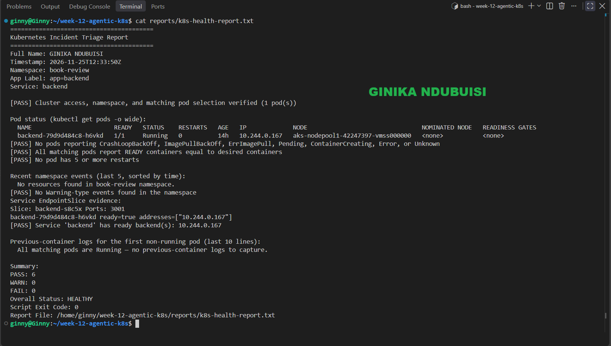

---

#### Screenshot 10 — Captured exit code and final summary

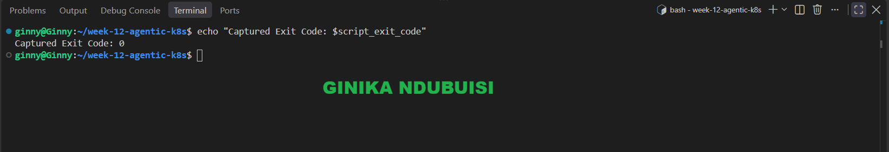

### Notes

**1. What is the baseline status?**

HEALTHY, with 6 PASS, 0 WARN, 0 FAIL and exit code 0.

**2. Which evidence proves the Service has a ready backend?**

The EndpointSlice backend-s8c5x lists Pod backend-79d9d484c8-h6vkd with ready=true at 10.244.0.167 on port 3001.

**3. What is the difference between a warning and a failure?**

A warning needs review but does not prove the app is broken. A failure means a required check failed and the app is unhealthy.

---

# Task 6 — Configure and Run the Claude Code Skill

## Goal

Connect the Bash script to a manually invoked Claude Code evidence-analysis workflow.

### Evidence

#### Screenshot 11 — SKILL.md showing frontmatter and safety rules

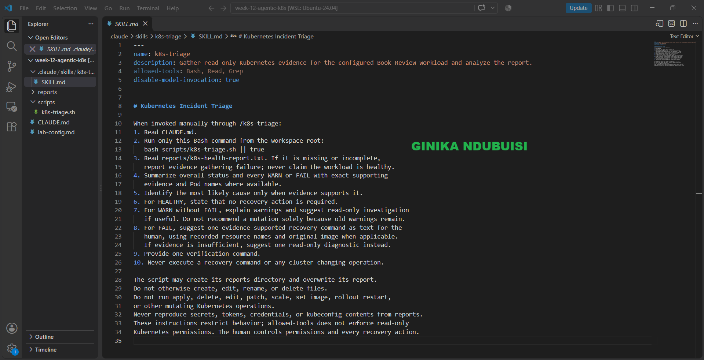

---

#### Screenshot 12 — Baseline `/k8s-triage` analysis

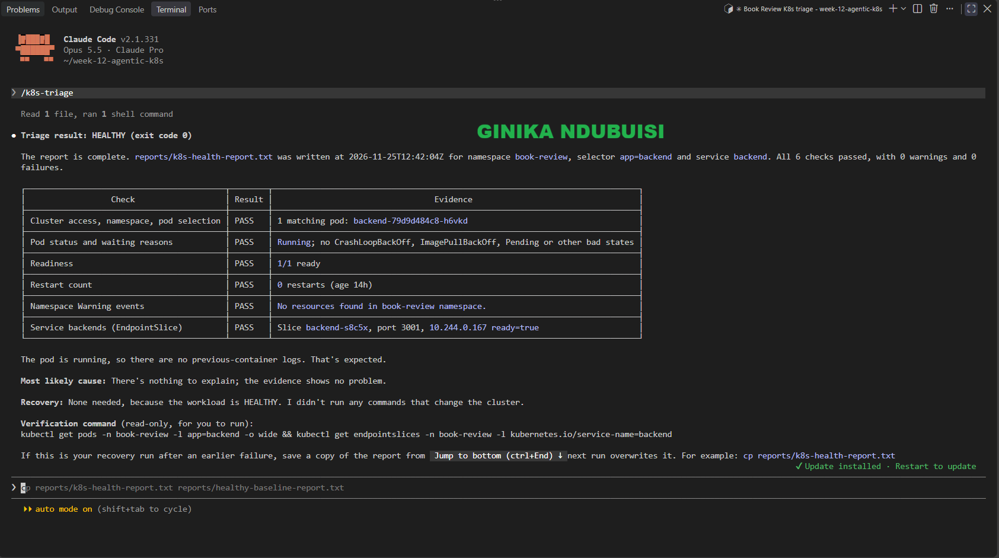

### Notes

**1. What does Bash do in this workflow?**

It runs the read-only kubectl checks, collects the evidence and writes the health report.

**2. What does Claude do in this workflow?**

It runs the script, reads the report, explains the results and suggests recovery commands as text only.

**3. Why are instructions alone insufficient to guarantee read-only access?**

Because Claude could still run a cluster-changing command if allowed, so only permissions and human approval can enforce read-only access.

---

# Task 7 — Simulate One Controlled Incident

## Goal

Create one controlled failure, save its evidence, and let Claude analyze it without executing recovery.

### Evidence

#### Screenshot 13 — Failed or unready Pod evidence and current Service backends

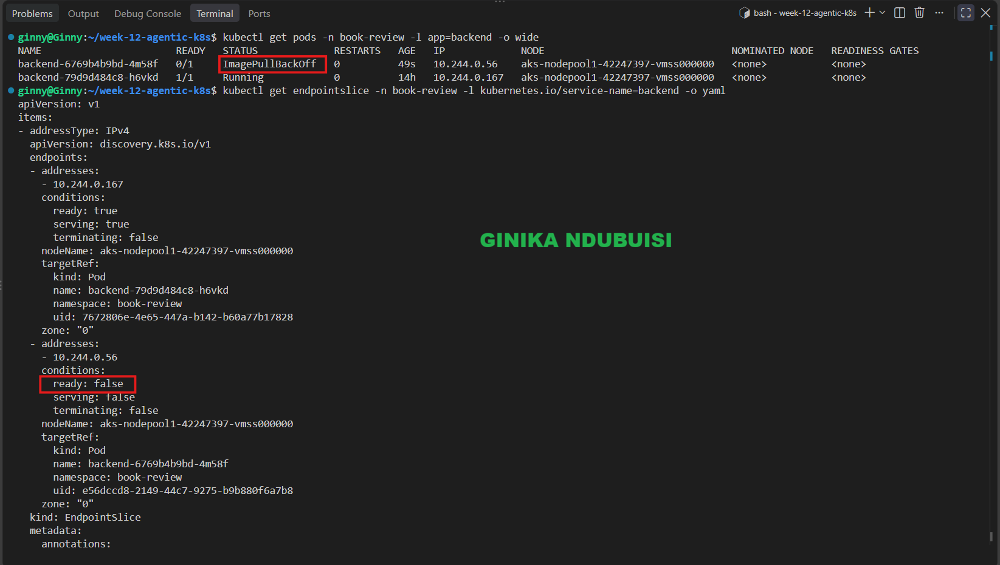

---

#### Screenshot 14 — Failed `/k8s-triage` analysis with evidence and a suggested manual recovery command

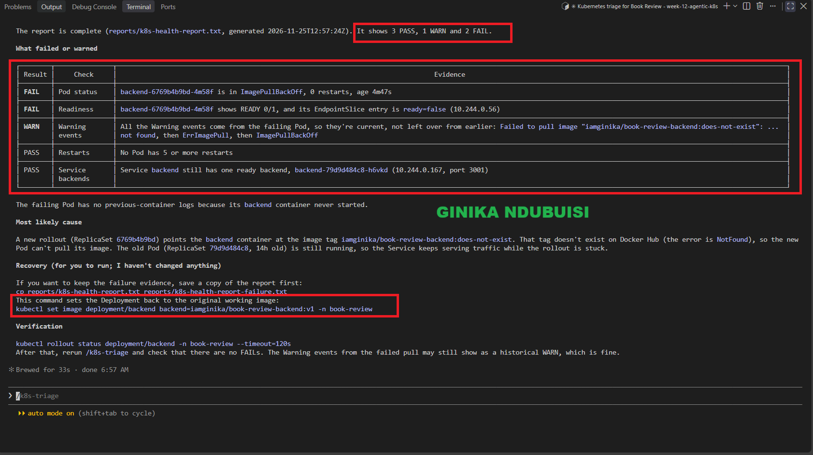

---

#### Screenshot 15 — Saved `incident-failure-report.txt`

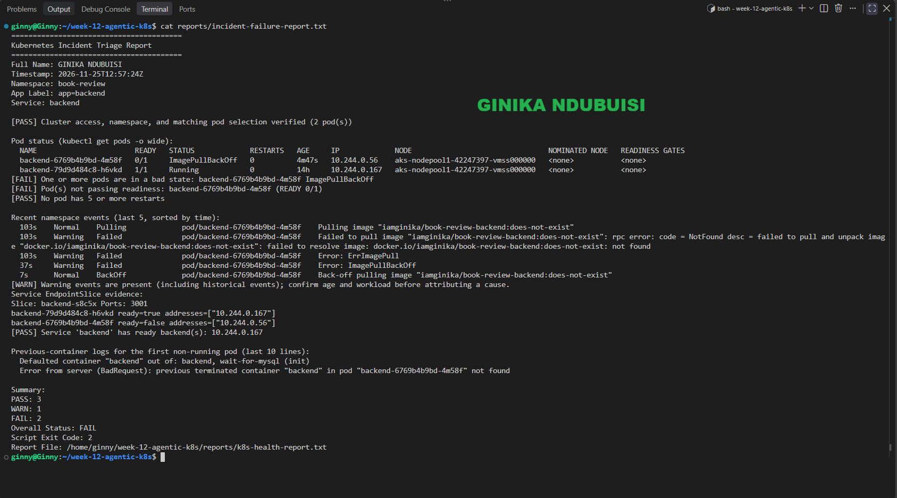

### Notes

**1. Which failure did you choose?**

An invalid image. I set the backend container's image to iamginika/book-review-backend:does-not-exist.

**2. Which checks failed, and what evidence proved it?**

Pod status and Pod readiness failed. Pod backend-6769b4b9bd-4m58f showed ImagePullBackOff at READY 0/1, and the events showed "failed to resolve image … does-not-exist: not found".

**3. Did Claude execute recovery? Why is that important?**

No. Claude only suggested the recovery command as text. This matters because a human must check and approve any change to the cluster.

**4. Why might the Service retain ready backends during the incident?**

It is because the old Pod backend-79d9d484c8-h6vkd stayed running and ready (ready=true) while the new Pod failed. Kubernetes does not remove the old Pod until the new one is ready.

---

# Task 8 — Recover Manually and Verify

## Goal

Restore the healthy configuration yourself and verify recovery using a second triage report.

### Evidence

#### Screenshot 16 — Recovered Pods and ready Service backends

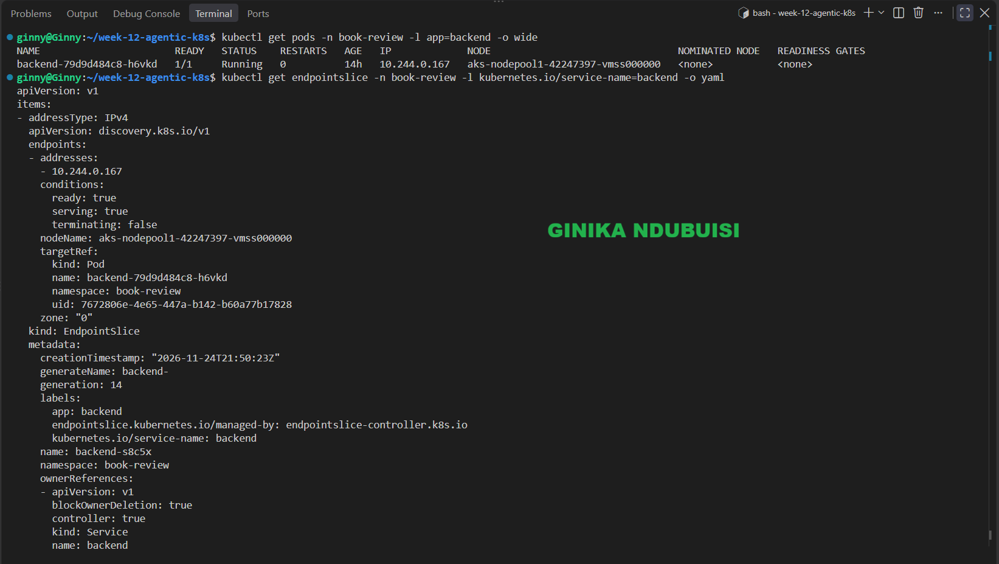

---

#### Screenshot 17 — Recovered `/k8s-triage` analysis

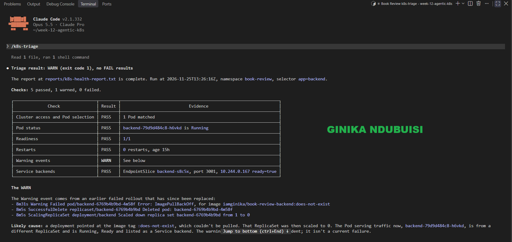
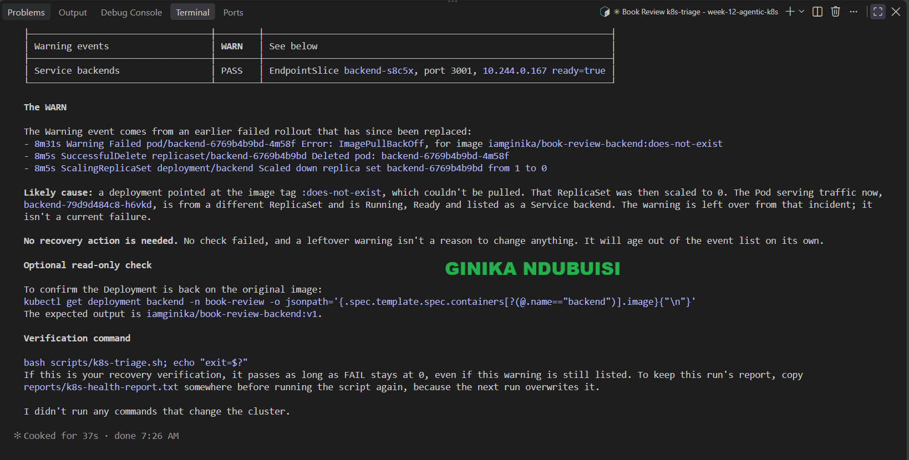

---

#### Screenshot 18 — Reports directory showing failure and recovery reports

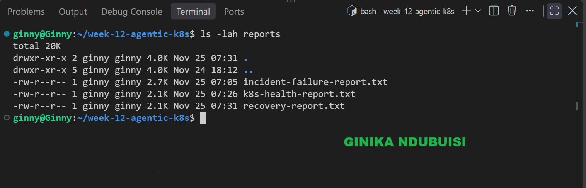

---

#### Screenshot 19 — `incident-summary.md` with all required sections

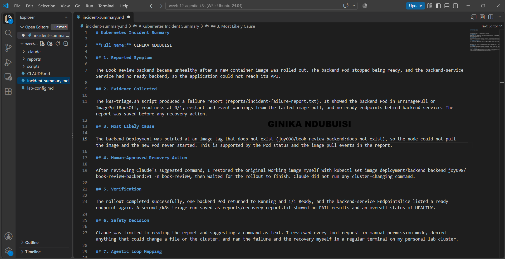

### Notes

**1. What manual recovery action did you execute?**

I ran kubectl set image deployment/backend backend=iamginika/book-review-backend:v1 -n book-review.

**2. What proves the workload recovered?**

The backend Pod backend-79d9d484c8-h6vkd is 1/1 Running with 0 restarts, the EndpointSlice shows 10.244.0.167 ready=true, and the recovery report has 0 FAIL.

**3. Why is the second triage run necessary?**

To confirm with the same checks that the recovery fixed the problem.

**4. Why should AI not automatically restart every failing production workload?**

A restart may not fix the cause, can destroy evidence and can make an outage worse.

### Remaining WARN Results

Explain any WARN results remaining after recovery, or write “None.”

The recovery report shows one WARN (exit code 1) from historical Warning events left by the incident Pod backend-6769b4b9bd-4m58f (ImagePullBackOff for the does-not-exist image). That Pod and its ReplicaSet were removed during recovery. The current Pod is Running, Ready, and listed as a ready Service backend, so no action is needed, and the events will expire on their own.

---

# Task 9 — Publish Your Kubernetes Incident-Triage Workflow on LinkedIn

## Goal

Share the incident-triage workflow you completed and explain the role of human control.

### Evidence

#### Screenshot 20 — Published LinkedIn post about your Kubernetes incident-triage workflow

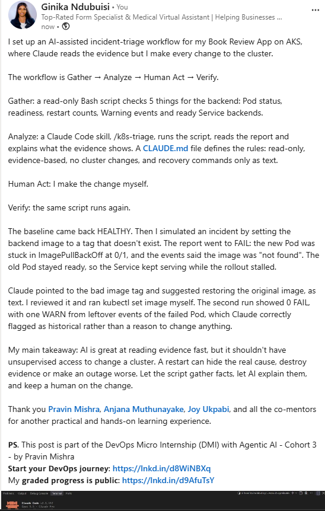

### LinkedIn Post URL

https://www.linkedin.com/posts/ginikandubuisi_i-set-up-an-ai-assisted-incident-triage-workflow-share-7531705400359059457-h02n/?utm_source=share&utm_medium=member_desktop&rcm=ACoAAD6T0TgBum59kWGrvQdH9mZyCcgf18-giQo

---

# Required Project Files

Include these files in your project repository:

- `CLAUDE.md`
- `lab-config.md`
- `scripts/k8s-triage.sh`
- `.claude/skills/k8s-triage/SKILL.md`
- `reports/incident-failure-report.txt`
- `reports/recovery-report.txt`
- `incident-summary.md`

Your `incident-summary.md` must contain:

1. Reported Symptom
2. Evidence Collected
3. Most Likely Cause
4. Human-Approved Recovery Action
5. Verification
6. Safety Decision
7. Agentic Loop Mapping

---

# Final Summary

## Evidence and Cause

Summarize the evidence and the supported cause of the incident.

After I set the backend image to iamginika/book-review-backend:does-not-exist, the triage report returned FAIL (exit code 2). The new Pod backend-6769b4b9bd-4m58f was in ImagePullBackOff at READY 0/1, and the namespace events showed "failed to resolve image … does-not-exist: not found". The EndpointSlice listed the new Pod as ready=false, while the original Pod backend-79d9d484c8-h6vkd stayed ready=true and kept serving. There were no previous-container logs, because the new container never started. The supported cause was an image tag that does not exist in Docker Hub.

## Manual Recovery

Describe the command or configuration change you performed.

In a separate terminal, I ran kubectl set image deployment/backend backend=iamginika/book-review-backend:v1 -n book-review to restore the original image recorded in lab-config.md, and waited for the rollout to complete.

## Verification

Explain how the recovery report and Kubernetes outputs confirmed recovery.

After recovery, the backend Pod was 1/1 Running with 0 restarts, and the EndpointSlice showed 10.244.0.167 as ready=true. I ran /k8s-triage again and saved the result as reports/recovery-report.txt. It showed 0 FAIL, and the only WARN was the leftover incident events, which Claude also identified as historical and not requiring action.

## Safety Decision

Explain how you kept Claude’s role limited to evidence gathering and analysis.

CLAUDE.md and SKILL.md limited Claude to running the read-only triage script and analysing its report. Claude suggested the recovery command as text only. I ran both the incident and the recovery myself in a separate terminal, and I checked Claude's tool activity after each run to confirm it made no cluster changes. Each /k8s-triage response ended with "I didn't run any commands that change the cluster."

---

# Submission Instructions

- Include all 20 required screenshots under their corresponding Evidence sections.
- Complete all Notes questions in your own words.
- Include the required project files in your linked repository.
- Include your published LinkedIn post URL.
- Use clear, readable screenshots showing relevant commands, configuration, and outputs.
- Display your full name before taking required terminal screenshots.
- Preserve the failure report before recovery.
- Ensure the baseline and recovery reports contain no FAIL results.
- Explain any WARN results remaining after recovery.
- Review reports, logs, configuration records, and screenshots before publishing.
- Do not expose credentials, kubeconfig contents, tokens, certificates, JWT secrets, or confidential account information.

---

# Completion Checklist

- [ ] Confirmed the personal lab context
- [ ] Discovered and recorded application configuration
- [ ] Recorded the original working image
- [ ] Captured healthy Pods and ready Service backends (Screenshot 1)
- [ ] Created the workspace (Screenshot 2)
- [ ] Configured CLAUDE.md (Screenshot 3)
- [ ] Reviewed the five-check triage plan (Screenshot 4)
- [ ] Configured and reviewed the supplied script (Screenshots 5–7)
- [ ] Passed Bash syntax validation and set executable permission (Screenshot 8)
- [ ] Captured a baseline report with no FAIL (Screenshot 9)
- [ ] Captured the correct exit code (Screenshot 10)
- [ ] Configured and invoked `/k8s-triage` (Screenshots 11–12)
- [ ] Simulated one controlled incident manually (Screenshot 13)
- [ ] Reviewed Claude’s failed-state analysis (Screenshot 14)
- [ ] Saved failure evidence before recovery (Screenshot 15)
- [ ] Executed recovery manually and waited for rollout completion
- [ ] Confirmed recovered Pods and ready Service backends (Screenshot 16)
- [ ] Captured recovery analysis with no FAIL (Screenshot 17)
- [ ] Explained any remaining warnings
- [ ] Saved failure and recovery reports (Screenshot 18)
- [ ] Completed the seven-section incident summary (Screenshot 19)
- [ ] Answered all Notes questions
- [ ] Published the LinkedIn post (Screenshot 20)
- [ ] Included the LinkedIn post URL
- [ ] Included all required project files
- [ ] Checked that no sensitive information is exposed

---

## 📌 About DMI & CloudAdvisory

DevOps Micro Internship (DMI) is a project-based DevOps program run by Pravin Mishra (The CloudAdvisory) focused on real-world execution, systems thinking, and career readiness.

It helps learners build strong DevOps foundations with hands-on experience.

---

## 📌 Resources

- 🌐 DMI Official Website: https://dmi.pravinmishra.com?utm_source=github&utm_medium=readme  
- 🎓 University: https://university.pravinmishra.com?utm_source=github&utm_medium=readme  
- 💬 Discord Community: https://discord.pravinmishra.com?utm_source=github&utm_medium=readme  
- 📝 Blog: https://dmi.pravinmishra.com/blog?utm_source=github&utm_medium=readme  
- ▶️ YouTube Playlist: https://www.youtube.com/playlist?list=PLFeSNDtI4Cho  
- 🔗 Pravin Mishra (LinkedIn): https://www.linkedin.com/in/pravin-mishra-aws-trainer/  
- 🏢 CloudAdvisory (LinkedIn): https://www.linkedin.com/company/thecloudadvisory/

---

*This submission is part of DevOps Micro Internship (DMI) — Agentic AI Track.*
